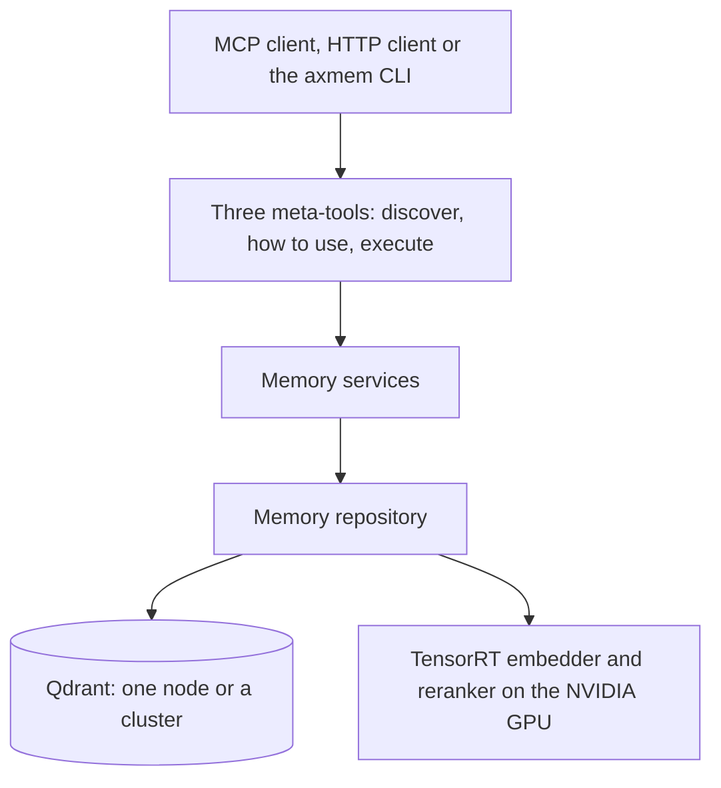

<h1 align="center">Axmem</h1>

<p align="center">
  
  
  
  <a href="https://github.com/jlowin/fastmcp">
    
  </a>
  <a href="https://developer.nvidia.com/tensorrt">
    
  </a>
  <a href="https://scorecard.dev/viewer/?uri=github.com/Axiumine/axmem">
    
  </a>
  <a href="https://www.bestpractices.dev/projects/16062">
    
  </a>
</p>


**Axmem** is a standalone memory server for AI agents, built as a Model Context Protocol (MCP) server on the FastMCP framework. Once connected, MCP clients such as coding agents, chatbots or your own custom agents can store and retrieve information from the same knowledge base. It is one process and one [Qdrant](https://qdrant.tech/) database: the embeddings model and the reranking model run inside the server on an NVIDIA GPU, so no other service is needed.

> **Axmem** is maintained by [Axiumine](https://github.com/Axiumine). It starts from the
> [Forgetful](https://github.com/ScottRBK/forgetful) codebase by Scott Raisbeck (MIT) and goes
> in directions an upstream-tracking fork cannot. Shipped so far: fewer features, and embeddings and reranking
> computed in this process on an NVIDIA GPU with TensorRT (see [GPU models](docs/gpu-models.md)), so Axmem needs no
> model service on the network, and **Qdrant as the only store** (SQLite, PostgreSQL and Alembic are gone, and
> memory ids are UUIDs). Every change, its reason and its status are listed in
> [docs/changes-from-forgetful.md](docs/changes-from-forgetful.md) and [CHANGELOG.md](CHANGELOG.md).
>
> See [License](#license) for attribution.

---

## Table of Contents

- [Overview](#overview)
- [Features](#features)
- [Quick Start](#quick-start)
- [CLI](#cli)
- [Usage Examples](#usage-examples)
- [How It Works](#how-it-works)
- [Configuration](#configuration)
- [Documentation](#documentation)
- [Contributing](#contributing)
- [License](#license)

---

## Overview
Many of us now work with AI agents, especially in software development. Work and decisions move fast, which makes it hard to keep up with notes and context persistence.

So if you are following something like the [BMAD Method](https://github.com/bmad-code-org/BMAD-METHOD) for example and you want to take the brainstorming session you've just had with Claude on your desktop or phone and use it as the basis of your next Claude Code session, then having a shared knowledge base across the two agents can help with this.

This is just one example. As more agentic applications appear, so will the use cases for sharing data across them.

Knowledge bases are becoming a key infrastructure component for interactions with AI. There are many excellent knowledge base solutions available (many of them free on GitHub), so check them out and find one that works for you, even if it isn't Axmem. Interactions with agents get easier and more rewarding once they know more about you, your work and your previous interactions with them or other AI systems.

What makes **Axmem** different from other memory-based MCP services is that it takes an opinionated view on how AI agents should store and retrieve data.

**Axmem** imposes the [Zettelkasten principle](https://en.wikipedia.org/wiki/Zettelkasten) when clients wish to record memories, that is, each memory must be atomic (one concept per note). Along with the note (title and content), we also ask the client / agent to provide context around what it was doing when creating the note, along with keywords and tags. With this information we create semantic embeddings and store these to aid with later retrieval and in addition to this we also automatically link the memory to existing memories that have a particular similarity score, allowing for the automatic construction of a knowledge graph.

In this sense **Axmem** becomes a little like Obsidian for AI agents, where the auto linking nudges them in building up a graph of the knowledge.

We find, [as do others (A-MEM: Agentic Memory for LLM Agents)](https://arxiv.org/abs/2502.12110), all this helps in ensuring that when the agent requires relevant information from the memory system later, the correct information is returned.

Memories belong to a **tenant**, the owner of a set of memories, and a tenant never sees another tenant's memories. A memory can also carry an optional **project** scope, a free-form label that groups memories and narrows a search.

### Standalone

Axmem is complete without any other system. With its defaults it needs an NVIDIA GPU with the model files (fetched once from Hugging Face, or copied in), a Qdrant server and a value for `AUTH_MODE`. Remote embeddings (Azure, Google, OpenAI, Ollama or an HTTP gateway), a remote rerank service and JWT or introspection authentication are optional integrations: nothing contacts them unless you select them. The standalone end-to-end test runs the whole memory workflow with only the GPU, the model files and a Qdrant node, and it refuses every other network connection.

Axmem does one job: store, link, rank and retrieve memories. It has no task or plan tracker, document or file store, skills, entity graph or activity stream, and it keeps no user or project registry. A tenant is a name taken from the credential and a project is a label on a memory. Keep the other kinds of information in the tools built for them, and let an agent save the conclusions it draws from them as memories.




[architecture.md](architecture.md) describes the layers, the Qdrant store and the optional integrations in detail.

## Features
- Configure either **STDIO** or **HTTP** transport mechanism (or stand up two services to support both)
- Fail-closed authentication: JWT, token introspection or static bearer tokens, one tenant per credential; a server with no `AUTH_MODE` refuses to start
- Tenant isolation: a tenant reads and changes only its own memories, over MCP, REST and the CLI
- Meta-tool discovery: only three tools are exposed to the client application to preserve the context window.
- One datastore: [Qdrant](https://qdrant.tech/) 1.19 or newer holds the memories, their links and their vectors, on a single node or on a cluster. No SQL database, no migrations. Every write waits for the server and is made conditional where two writers could meet, so concurrent updates never silently lose one another (a lost race answers 409).
- Stores memories as vectors so they can be retrieved with natural-language queries from AI agents.
- Cross-encoder reranking to improve recall and precision of memory retrieval. It runs on an NVIDIA GPU with TensorRT 11 in strict fp32 and has no CPU path; see [GPU models](docs/gpu-models.md). A remote rerank service (`RERANKING_PROVIDER=HTTP`) or `RERANKING_ENABLED=false` runs without a GPU.
- Standalone embeddings: the default `TensorRT` provider runs `BAAI/bge-small-en-v1.5` in this process on an NVIDIA GPU (strict fp32, CLS pooling, unit-length vectors) with no model service on the network. It has no CPU path; see [GPU models](docs/gpu-models.md). Other providers are explicit choices: the optional HTTP embeddings gateway (`EMBEDDING_PROVIDER=gateway`, nothing reads a `GATEWAY_*` setting unless it is selected), Azure, Google, OpenAI or Ollama. Switching providers or dimensions needs a re-embed, see [Embedding Migration](docs/embedding_migration.md)
- Automatic linking of semantically similar memories, automating the creation of the knowledge graph.

For the complete roadmap, see [Features Roadmap](docs/features_roadmap.md).

---

## Quick Start

### Option 1: From Source

Axmem runs alone: the embeddings model and the reranking model both run in the server process on an
NVIDIA GPU (driver R580 or newer, CUDA 13), so besides Qdrant no other service is needed. The CUDA
runtime and TensorRT 11 come from `uv sync`; nothing else is installed system-wide. Without a visible
GPU, or without the TensorRT libraries or the model files, the server refuses to start and names the
cause; there is no CPU path and no fallback. The first start downloads the two models from Hugging Face
(about 260 MB) and builds one TensorRT engine for each (about 6 to 8 seconds each); later starts load the
cached engines in well under a second. On a host without internet access, copy the model directories
beforehand and set `HF_HUB_OFFLINE=1` ([Model files and offline hosts](docs/gpu-models.md#model-files-and-offline-hosts)). The explicit ways to run
without a GPU are another `EMBEDDING_PROVIDER` and `RERANKING_PROVIDER=HTTP` or `RERANKING_ENABLED=false`.
Details: [GPU models](docs/gpu-models.md).

```bash
git clone https://github.com/Axiumine/axmem.git
cd axmem

# Install dependencies with uv (downloads about 4 GB of TensorRT and CUDA libraries)
uv sync

# Qdrant must be running (see "Qdrant" below). Run the server. It fails closed: with no AUTH_MODE it
# refuses to start. AUTH_MODE=none serves one local tenant and is accepted only on stdio or
# when the HTTP server binds a loopback address (an address of 127.0.0.0/8, or ::1)
QDRANT_URL=http://127.0.0.1:6333 AUTH_MODE=none uv run main.py
```
The memories live in Qdrant. The models and engines are kept in platform-appropriate locations (`~/.local/share/axmem/models` on Linux).

The server starts with stdio transport, which is what MCP clients expect. For HTTP on this machine: `AUTH_MODE=none uv run main.py --transport http --host 127.0.0.1 --port 8020`. To keep `AUTH_MODE=none` out of every command, put it in `~/.config/axmem/.env`.

**Standalone HTTP server with a static bearer token**, using nothing but the GPU, the model files and Qdrant:

```bash
# the token stays secret; the server is configured with its SHA-256 hash only
TOKEN=$(openssl rand -hex 24)
echo "Authorization: Bearer $TOKEN"
AUTH_MODE=static \
AUTH_STATIC_TOKEN_HASHES="{\"me\": \"$(printf %s "$TOKEN" | sha256sum | cut -d' ' -f1)\"}" \
uv run main.py --transport http --host 0.0.0.0 --port 8020
```

No `EMBEDDING_PROVIDER`, `EMBEDDING_*` or `GATEWAY_*` setting is needed: the defaults are the TensorRT embedder
and the TensorRT reranker. The `/health` route answers without a token once both engines are loaded.

> **Note**: Axmem is on PyPI (`0.6.0rc1`, a release candidate): `uv tool install --extra-index-url https://pypi.nvidia.com axmem` puts the `axmem` command on the `PATH`, and `uvx axmem` runs it without installing, so the `uvx axmem` commands in the client guides work as written. With `axmem` installed, it replaces `uvx axmem` in those examples. A checkout, a Git URL or a built wheel are the alternatives (development); all of them are described in [Installing the package](#installing-the-package).

### Installing the package

Axmem is installed from PyPI, a checkout, a Git URL or a built wheel. The package pins three TensorRT packages (`tensorrt-cu13`, `tensorrt-cu13-bindings`, `tensorrt-cu13-libs`), and a wheel cannot say where they live: NVIDIA's index (`https://pypi.nvidia.com`) holds the real files of all three. On PyPI, `tensorrt-cu13` and `tensorrt-cu13-libs` are placeholders (source packages that fetch the 3.8 GB of libraries from that index while they are built); only `tensorrt-cu13-bindings` is a real wheel there. `--extra-index-url` points the install at NVIDIA's files (no other package of Axmem is on that index, so everything else still comes from PyPI):

| Install from | Command |
|---|---|
| PyPI, with uv | `uv tool install --extra-index-url https://pypi.nvidia.com axmem` |
| PyPI, with pip | `pip install --extra-index-url https://pypi.nvidia.com axmem` |
| a checkout | `uv tool install .` (uv reads the index from `pyproject.toml`) |
| a Git URL, with uv | `uv tool install "git+https://github.com/Axiumine/axmem"` (the same) |
| a built wheel (`uv build`), with uv | `uv tool install --extra-index-url https://pypi.nvidia.com dist/axmem-*.whl` |
| a built wheel, with pip | `pip install --extra-index-url https://pypi.nvidia.com dist/axmem-*.whl` |
| a Git URL, with pip | `pip install --extra-index-url https://pypi.nvidia.com "git+https://github.com/Axiumine/axmem"` |

The environment needs Python 3.14. `0.6.0rc1`, the first release, is a release candidate; while PyPI holds no stable release, uv and pip pick it without `--pre`. Without the flag the two placeholders still install, but only while `pypi.nvidia.com` is reachable during the install.

### Option 2: Native setup for a shared server

Axmem runs directly on the host; there are no container images or compose files of its own. You need:

- [uv](https://docs.astral.sh/uv/) (it installs the Python 3.14 the project pins in `.python-version`)
- a Qdrant server of version 1.19.0 or newer (the tests run 1.19.2). The server checks the version of every node at start and refuses an older one

```bash
git clone https://github.com/Axiumine/axmem.git
cd axmem
uv sync --locked

# Settings come from environment variables; copy the reference file and edit it
cp .env.example .env
# In it set at least:
#   QDRANT_URL=http://127.0.0.1:6333   QDRANT_API_KEY=...
#   AUTH_MODE=jwt | introspection | static   (a shared server needs a credential, see below)

# Run the HTTP server (stdio is the default transport). Bound to all interfaces by default, it
# needs AUTH_MODE=jwt, introspection or static; AUTH_MODE=none needs SERVER_HOST=127.0.0.1
uv run main.py --transport http --port 8020
```

The HTTP server speaks plain HTTP unless it is given a certificate: set `SERVER_SSL_CERTFILE` and `SERVER_SSL_KEYFILE` (both or
neither; the start refuses one without the other, or a file it cannot load) to serve TLS 1.2 or later itself, or bind to a loopback
address behind a TLS-terminating reverse proxy. A server that is reachable beyond one machine and speaks plain HTTP logs a warning at
start. See [Serve TLS](docs/configuration.md#serve-tls).

Run it under your service manager of choice (for example a systemd unit whose `WorkingDirectory` is the clone and whose
`ExecStart` is `uv run main.py --transport http`). Environment variables set in the unit take precedence over the file.

**Note**: If no settings file exists, the application uses defaults from `app/config/settings.py`, except
`AUTH_MODE`, which has no default. For all configuration options, see [Configuration Guide](docs/configuration.md).

### Qdrant

Axmem keeps everything in Qdrant, in two collections: `<prefix>_memories` (an alias onto the live generation of the
memories and their vectors) and `<prefix>_links`. `QDRANT_COLLECTION_PREFIX` defaults to `axmem`. The collections are
created at start; an existing collection whose layout differs from the settings, or whose vectors another embedder
made, stops the server with an explanation and is never changed silently (`axmem re-embed` moves the data to a new
layout or embedder).

**One node** is the default (`QDRANT_URL=http://127.0.0.1:6333`). Give the node an API key (`QDRANT__SERVICE__API_KEY`)
and put the same value in `QDRANT_API_KEY`; it is a secret and is never logged. The key admits every tenant of the
instance, so tenant isolation is Axmem's job: use one Qdrant per trust domain.

**A three-node cluster** is the verified profile for availability: list the node URLs in `QDRANT_URL` separated by
commas, and set `QDRANT_SHARD_NUMBER=3`, `QDRANT_REPLICATION_FACTOR=3`, `QDRANT_WRITE_CONSISTENCY_FACTOR=2` before the
first start. Run the nodes with `QDRANT__CLUSTER__ENABLED=true`, the same API key on every node and
`QDRANT__SERVICE__ENFORCE_INTERNAL_AUTH=true`, so the nodes also authenticate to each other. Axmem sends every write
with strong ordering, waits for it, and reads back at quorum consistency. `axmem qdrant-check` reads each node on
its own and reports any node whose points differ; it only reports, repair is the operator's decision.

**Backups** have two lines. Qdrant snapshots (`axmem backup`) are the fast restore. The JSONL export
(`axmem export`, restored with `axmem import`) is the second line: it holds the memories and links without
vectors, and an import computes the vectors again with the configured model, so it also moves memories between
embedding models and between Qdrant versions. On a cluster a snapshot is per node and per shard: stop the writers,
check that the nodes agree (`axmem qdrant-check`), snapshot every node, and restore every node's file on the node it
came from (`QDRANT_URL` lists the same nodes in the same order; a node's snapshot holds only the shards it stores), then
check for leftover partial replicas. Aliases are not part of a snapshot. Details:
[Configuration Guide](docs/configuration.md#qdrant-configuration).

> **Warning: three operator commands replace data. Read this before you run them.**
>
> - **`axmem restore <dir> --yes` replaces the memories and links of every tenant in Qdrant with the snapshot's.** What was
>   written after the snapshot was taken is no longer in the live data, and the command keeps no copy of it. Stop every server
>   and take a fresh `axmem backup` (and `axmem export`) first. Without `--yes` it changes nothing.
> - **`axmem export <file>` replaces a file that already has that name, and `<file>.partial`, without asking.** Give it a
>   new name.
> - **`axmem re-embed` starts at once, with no confirmation, and needs every server stopped.** It keeps the previous memory
>   collection, but when the `QDRANT_SHARD_NUMBER`, `QDRANT_REPLICATION_FACTOR` or `QDRANT_WRITE_CONSISTENCY_FACTOR` settings
>   changed it moves the links into a new collection and removes the old links collection. Run `--dry-run` first, and take
>   an `axmem backup` if you want to be able to go back.

### Authentication and tenants

Every request acts as one tenant. `AUTH_MODE` decides how the tenant is found, and the server will not start without it:

| `AUTH_MODE` | Credential | Tenant |
|---|---|---|
| `jwt` | Signed JWT as `Authorization: Bearer` | Claim `tenant_id`, else `tenant`, else `sub` |
| `introspection` | Opaque bearer token checked at an RFC 7662 endpoint | Same claim order |
| `static` | Fixed bearer token per tenant; only its SHA-256 hash is configured (`AUTH_STATIC_TOKEN_HASHES`) | The tenant the token is configured for |
| `none` | None | `DEFAULT_TENANT` |

`AUTH_MODE=none` is accepted only on stdio or on a loopback bind (any address of `127.0.0.0/8`, such as `127.0.0.1`, or `::1`; a host name such as `localhost` does not count); on any other address the server refuses to
start. The check sees the bind address only: if a proxy, a tunnel or a port mapping forwards to the loopback port, every caller
is the default tenant, so use `jwt`, `introspection` or `static` for anything that is not strictly local. A credential-free HTTP server also
answers `421` to a `Host` that is not a loopback name and `403` to a foreign `Origin`, so a web page cannot drive it by DNS rebinding or a
cross-origin POST. `jwt` needs `FASTMCP_SERVER_AUTH_JWT_ISSUER` and `FASTMCP_SERVER_AUTH_JWT_AUDIENCE` (the server refuses to start without them) and a
token with an `exp` claim. `AXMEM_SCOPES` and the scopes of a token limit the REST routes as they limit the MCP tools (`403` for a tool that is not
permitted). The GitHub and Google OAuth providers and the CLI browser login are removed. See the
[Configuration Guide](docs/configuration.md#authentication-configuration) for the details and for generating a static token hash.

### Connecting to an Agent

For detailed connection guides (Claude Code, Claude Desktop, other clients that support MCP), see [Connectivity Guide](docs/connectivity_guide.md).

- [Claude Code](docs/connectivity_guide.md#claude-code)
- [VS Code](docs/connectivity_guide.md#vs-code)
- [Copilot CLI](docs/connectivity_guide.md#copilot-cli) (includes [custom agents and skills](docs/copilot-cli/README.md))
- [Cursor](docs/connectivity_guide.md#cursor)
- [Codex](docs/connectivity_guide.md#codex)
- [Gemini CLI](docs/connectivity_guide.md#gemini-cli) (includes [custom commands](docs/gemini-cli/README.md))
- [Opencode](docs/connectivity_guide.md#opencode) (includes [custom commands and skills](docs/opencode/README.md))

Add Axmem to your MCP client configuration (replace `/path/to/axmem` with your clone):

**stdio transport (recommended for local use):**
```json
{
  "mcpServers": {
    "axmem": {
      "type": "stdio",
      "command": "uv",
      "args": ["run", "--directory", "/path/to/axmem", "main.py"],
      "env": { "AUTH_MODE": "none" }
    }
  }
}
```

**HTTP transport (for remote or shared use):**
```json
{
  "mcpServers": {
    "axmem": {
      "type": "http",
      "url": "https://axmem.example.com/mcp",
      "headers": { "Authorization": "Bearer <token>" }
    }
  }
}
```

A local HTTP server started with `AUTH_MODE=none` needs no header (`http://localhost:8020/mcp`).


---

## CLI

The `axmem` command is also a full terminal client over the same tool registry the
MCP meta-tools use - against your local Qdrant by default (as the `DEFAULT_TENANT` tenant), or a remote
deployment after `auth login`, as the tenant that `AXMEM_TOKEN` names.

```bash
# From PyPI (0.6.0rc1, a release candidate; this installs the `axmem` command)
uv tool install --extra-index-url https://pypi.nvidia.com axmem

# Curated verbs for daily use
axmem memory save "Set generateResolvConf false to fix WSL2 DNS" \
    --title "WSL2 DNS fix" --importance 7
axmem memory search "wsl dns" -c "wsl networking" -n 5
axmem memory get 018f2c3e-0000-7000-8000-000000000042
axmem memory recent -n 10 -p my-project

# Generic passthrough to any available tool
axmem tools list --category memory
axmem tools info query_memory
axmem call get_recent_memories --args '{"limit": 5, "project": "homelab"}'

# Remote deployment (bearer token from the environment; saves AXMEM_SERVER to ~/.config/axmem/.env)
export AXMEM_TOKEN="<token>"
axmem auth login --server https://axmem.example.com
axmem auth status
axmem memory search "wsl dns" -c "wsl networking"          # now runs remotely
axmem memory search "wsl dns" -c "wsl networking" --local  # force local mode per invocation

# Scripting: --json emits machine-readable output
axmem memory search "wsl dns" -c "wsl networking" --json | jq '.primary_memories[0].id'

# Operator commands, run against Qdrant itself (see "Qdrant" above)
axmem backup                     # snapshot every node into the backup directory
axmem restore <backup-dir> --yes # replaces every tenant's memories and links, see the warning above; stop every server first
axmem export memories.jsonl      # portable, without vectors; replaces a file of that name
axmem import memories.jsonl      # embeds each memory again
axmem qdrant-check               # compare the nodes of a cluster, report only
```

`axmem serve` is the canonical way to run the MCP server (`axmem serve
--transport http --port 8020`); the bare `axmem` invocation and
the legacy `--transport`/`--re-embed` flags keep working indefinitely, so existing MCP
client configurations are unaffected. A remote deployment is reached with the bearer token in
`AXMEM_TOKEN`; there is no browser login. See the
[Configuration Guide](docs/configuration.md#cli-configuration) for precedence rules, or walk
through the [`axmem-cli-setup`](skills/axmem-cli-setup/SKILL.md) skill for install,
auth, and verification steps end-to-end.


---

## Usage Examples

Axmem exposes only three meta-tools to MCP clients. The tools available through
`execute_axmem_tool` depend on the permitted scopes. Use
`discover_axmem_tools` for the current runtime catalog.

### Example 1: Project-Scoped Memory

Give a memory a project scope for better organization and scoped retrieval. A project is just a label;
it is created the first time it is used, so there is nothing to set up first.

```python
# Create a memory in the "ecommerce-redesign" project scope
memory = execute_axmem_tool(
    "create_memory",
    {
        "title": "Payment gateway: Stripe chosen over PayPal",
        "content": "Selected Stripe for its API, fees, and fraud detection.",
        "context": "Choosing the payment provider for the redesign",
        "keywords": ["payment", "stripe", "paypal"],
        "tags": ["payment", "decision"],
        "importance": 9,
        "project": "ecommerce-redesign"
    }
)

# Later, query within project scope
results = execute_axmem_tool(
    "query_memory",
    {
        "query": "payment processing implementation",
        "query_context": "Implementing payments for the redesign",
        "project": "ecommerce-redesign"
    }
)
# Returns: Stripe decision + auto-linked related memories
```

### Tool Categories

The catalog covers memories, with an optional project scope on create, update, query and recent.

For complete documentation with extensive examples, see [Complete Tool Reference](docs/tool_reference.md).

---

## How It Works

### Atomic Memory Principle

Inspired by Zettelkasten, each memory stores **one concept** in ~300-400 words:
- **Easily titled** – Forces clarity (200 char limit)
- **Self-contained** – Understandable without external context
- **Linkable** – Small units enable precise knowledge graphs

For detailed content, split it into 3-7 atomic memories and link them to each other.

### Automatic Knowledge Graph

When you create a memory:
1. **Embedding generated** – the embeddings model (`bge-small-en-v1.5` on the GPU by default) converts content to a 384-dimensional unit-length vector
2. **Similarity search** – Finds related memories (similarity ≥0.7 by default)
3. **Auto-linking** – Creates bidirectional links to top 3-5 matches (configurable)
4. **Graph traversal** – Queries return primary results + 1-hop linked memories

### Token Budget Management

Prevents context window overflow:
- Configurable budget (default 8K tokens)
- Search finds relevant memories; primary results are then sorted by importance (high first)
- Equal-importance primary results keep their search order, even when nothing is truncated
- Truncates gracefully if over budget
- Respects max memory count (default 20)

This keeps query results within the LLM's context budget.

For vector search and optional cross-encoder reranking, see
[Search Documentation](docs/search.md).

---

## Configuration

**No configuration required** – Axmem uses sensible defaults out of the box.

### Key Settings (Optional)

- `MEMORY_TOKEN_BUDGET` – Max tokens for query results (default: `8000`)
- `EMBEDDING_PROVIDER` – `TensorRT` (default, in-process on the GPU), `Azure`, `Google`, `OpenAI`, `Ollama` or `gateway`
- `EMBEDDING_MODEL` – For `TensorRT`, the Hugging Face repository of the ONNX model (default: `BAAI/bge-small-en-v1.5`)
- `EMBEDDING_DIMENSIONS` – Vector width (default: `384`); checked against the model at startup (`TensorRT`) and against every reply of a remote provider
- `RERANKING_ENABLED` – Rerank search results (default: `true`; needs an NVIDIA GPU unless `RERANKING_PROVIDER=HTTP`)
- `RERANKING_PROVIDER` – `TensorRT` (default, local GPU) or `HTTP`
- `MEMORY_NUM_AUTO_LINK` – Auto-link count (default: `3`, set `0` to disable)
- `MEMORY_SIMILARITY_THRESHOLD` – Minimum cosine similarity for auto-links (default: `0.7`)
- `SERVER_PORT` – HTTP server port (default: `8020`)
- `SERVER_SSL_CERTFILE`, `SERVER_SSL_KEYFILE`, `SERVER_SSL_KEYFILE_PASSWORD` – PEM files that make the HTTP server serve TLS (default: empty, plain HTTP); both files or neither
- `AUTH_MODE` – `none`, `jwt`, `introspection` or `static`; no default, the server will not start without it

For all environment variables with detailed explanations, see [Configuration Guide](docs/configuration.md).

---

## Documentation

### Guides

- [Core Concepts](docs/concepts.md) – Memories, tenants and project scopes explained
- [Complete Tool Reference](docs/tool_reference.md) – Runtime tools and examples
- [REST API Reference](docs/api_reference.md) – HTTP endpoints for web UI integration
- [Configuration Guide](docs/configuration.md) – All environment variables explained
- [Connectivity Guide](docs/connectivity_guide.md) – Connect Claude and other MCP clients
- [Nix Guide](docs/nix.md) – Reproducible dev shell and builds with Nix flakes
- [Search Documentation](docs/search.md) – Embedding pipeline and retrieval architecture
- [Embedding Migration](docs/embedding_migration.md) – Switch embedding providers safely
- [GPU models](docs/gpu-models.md) – NVIDIA host requirements, the embedder and the reranker, TensorRT engine cache, TF32 and GPU memory
- [Features Roadmap](docs/features_roadmap.md) – Planned features and priorities
- [Changelog](CHANGELOG.md) – Notable changes to Axmem by section
- [Changes from Forgetful](docs/changes-from-forgetful.md) – Every difference from upstream, the reason and its status

### Security and project

- [Security policy](SECURITY.md) – How to report a vulnerability privately
- [Security guide](docs/security.md) – The security model of Axmem and how to run it securely
- [Assurance case](docs/assurance-case.md) – Why the security claims of the project hold, and the evidence for each
- [Roadmap](docs/roadmap.md) – What the project plans to do next
- [Governance](GOVERNANCE.md) and [Maintainers](MAINTAINERS.md) – Who decides, who has access and what happens if the lead maintainer is unavailable
- Releases are signed with cosign (keyless) and carry SLSA level 3 provenance; PyPI files carry a PEP 740 attestation. To check one, see [Checking a release](docs/release.md#checking-a-release).

### External Resources

- [MCP Protocol Specification](https://modelcontextprotocol.io/) – Model Context Protocol docs
- [Qdrant](https://qdrant.tech/) – vector database, the only datastore
- [TensorRT](https://developer.nvidia.com/tensorrt) – GPU inference for the embedder and the reranker
- [Zettelkasten Principle](https://en.wikipedia.org/wiki/Zettelkasten) – Atomic note-taking method

---

## Contributing

See [CONTRIBUTING.md](CONTRIBUTING.md) first. Axmem runs on NVIDIA GPUs only and will not be made to run on other devices on
request; the one exception is a pull request that adds Apple silicon with an MLX backend. Report a vulnerability as
[SECURITY.md](SECURITY.md) says, not in an issue.

We welcome contributions! Axmem uses integration + E2E testing on a real NVIDIA GPU (the embedder and reranker tests run the actual TensorRT engines; there is no CPU or skip path). Docker is needed to start the real Qdrant node (and the three-node cluster) the suites run against.

See [Contributors Guide](docs/contributors.md) for:
- Testing workflows (integration tests, E2E tests, GitHub Actions)
- Development setup and running from source
- CI/CD pipeline details
- Release process

### Development

Python 3.14 is the supported version. After `uv sync --locked --all-extras --dev`, enable the
Git hooks with `uv run python -m scripts.quality install`. Commits and pushes then run every check of the project as a
gate (lint, shell and workflow lint, type, security, package and wheel, snapshot, coverage (100 %), memory-budget and
mutation gates) described in
[docs/quality-gates.md](docs/quality-gates.md), which also explains how to run or bypass a single gate.

The `pre-push` hook is the GPU gate: GitHub Actions runs only the static checks (hosted runners have no GPU, and there is
no self-hosted runner), so the integration, end-to-end and cluster suites, the 100 % coverage gate, the memory budgets and
Qodana run on the machine that pushes, and a push is refused when one fails or when the machine has no NVIDIA GPU or no
Docker daemon.

Before changing code, read the [architecture overview](architecture.md).

---

## License

Copyright (C) 2026 Giovanni Manzoni <dev@giovannimanzoni.com>

Axmem is released under the [GNU Affero General Public License, version 3](LICENSE) (`AGPL-3.0-only`), the skills in
[skills/](skills/) included. If you modify Axmem and let others use it over a network, section 13 of the license
requires you to offer those users the source code of your modified version.

It is derived from [Forgetful](https://github.com/ScottRBK/forgetful), Copyright (c) 2025 Scott Raisbeck, which is
released under the MIT License. The original copyright and permission notice is kept unchanged in
[LICENSE-FORGETFUL-MIT.md](LICENSE-FORGETFUL-MIT.md), as that license requires; the MIT License allows the derived
work to be released under the AGPL.

The models and the NVIDIA libraries that Axmem uses are not part of this release and have licenses of their own: see
[Licenses of the models and libraries](docs/gpu-models.md#licenses-of-the-models-and-libraries). The wheel and the sdist
hold Axmem's source and nothing else: the `package` quality gate, which also checks the files `publish.yml` uploads, refuses
a build that carries model weights, TensorRT engines or NVIDIA libraries.
