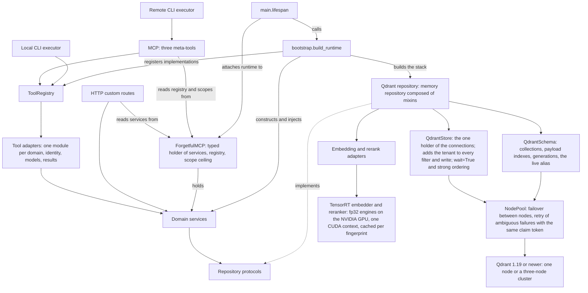

# Forgetful architecture

Reviewable, agent-authored overview, checked against source on 2026-10-08, with boundary changes checked on 2026-10-17
and the structure re-verified on 2026-10-19 against the `quality-gates` branch (`37ee70f`), then updated for the
removal of the graph REST view and subgraph traversal, of plans and tasks, of skills, of files, of documents and
code artifacts, of entities, of the activity bus and stream, and of the container deployment, and for tenants,
fail-closed authentication and projects reduced to a scope string, and for batched embedding with the optional
`gateway` embeddings provider, and for the direct TensorRT 11 reranker on the NVIDIA GPU (replacing the FastEmbed
cross-encoder), and for the in-process TensorRT embeddings provider that is now the default, and for the removal of
ONNX Runtime and the FastEmbed CPU embedder, and for Qdrant as the only store (SQLite, PostgreSQL, SQLAlchemy and
Alembic are gone; memory ids are UUIDs; tenants have no stored record), on the `axmem` branch.
This is a selective interpretation, not an exhaustive dependency inventory.
The component groupings below are inferred for readability; the described execution paths
and wiring were verified against source. Line numbers are inspection starting points and may drift.

Forgetful provides persistent, semantically searchable memories and related knowledge through
MCP tools, HTTP endpoints, and a CLI. Its intended boundary is
**routes → services → protocols → repositories/adapters**, as described in [AGENTS.md](AGENTS.md).
Protocols are Python contracts, not an extra runtime process: services call injected implementations.
Qdrant, provider clients, and the HTTP clients of remote providers normally stay behind those contracts.
Operational exceptions are called out below rather than hidden by the diagram.
The server runs natively (`uv run main.py`, see the README); the repository ships no container image or compose files.
Docker appears only as a test dependency (the real Qdrant nodes the suites run against).

## Component view

Boxes combine multiple classes/files; unless a label names a module or package, they are not declared
packages or separate deployments.
Solid arrows show source-verified use or explicitly labelled startup wiring. Dotted arrows mean
structural implementation of a contract, not inheritance or a request passing through a protocol.
Only the memory repository uses the embedding/rerank branch; archive, backup and inspector adapters (see "Other domain
and operational components") use the same store and pool. Health/auth routes and operational
commands have additional paths omitted here; the diagram does not assert universal layering.

## Entry points and lifecycle

| Inspection point | Responsibility |
| --- | --- |
| [main.py:43](main.py#L43) | Server lifespan configures logging, calls `build_runtime`, attaches services/registry/scopes to the typed `ForgetfulMCP` instance ([server_state.py](app/routes/server_state.py)), then disposes the runtime on normal shutdown. Logging is deferred to protect STDIO transport. |
| [main.py:92](main.py#L92), [main.py:417](main.py#L417) | Construct the typed FastMCP subclass with the configured authentication provider; `_serve` first asks `ensure_startup_allowed` ([auth.py:146](app/config/auth.py#L146)) and exits with code 1 when the configuration is refused (see "MCP, HTTP, and identity"), then builds the embedder (`start_tensorrt_embedder`, only when `EMBEDDING_PROVIDER` is `TensorRT`) and the reranker (`get_reranker_adapter`) and exits with code 1 and `Error: the embedder cannot start: <cause>` or `Error: the reranker cannot start: <cause>` when a TensorRT engine cannot run (no GPU, missing libraries, driver, model, build failure or an embedding width that is not `EMBEDDING_DIMENSIONS`; see "Contracts, storage, and implementation variants"), then runs the app over STDIO or HTTP. Both HTTP branches run the app under Uvicorn directly so lifespan teardown (`dispose_runtime`) completes before a shutdown signal is re-raised; the CORS branch additionally wraps the app with Starlette middleware. |
| [main.py:577](main.py#L577) | Console entry point `cli`: a known subcommand goes to `parser.dispatch`; any other argv falls through to the permanent legacy launcher (`--transport`, `--re-embed`, ...), which rejects the re-embed-only flags when `--re-embed` is absent. |
| [bootstrap.py:197](app/bootstrap.py#L197) | Composition root: choose providers, connect to Qdrant and make the collections exist (`QdrantSchema.ensure` checks the server version and refuses a layout that differs from the settings), construct the repository, services, tool registry, and instance scope ceiling, and log what the TensorRT models did at start-up together with the GPU memory they hold and the one CUDA context they share (`log_tensorrt_models`). |
| [bootstrap.py:179](app/bootstrap.py#L179) | `Services` and `Runtime` (the services, the registry and the `QdrantStack` to close) collect the instances for front doors. This is explicit constructor injection, not a DI container. |
| [parser.py:268](app/routes/cli/parser.py#L268) | Dispatch CLI serve, re-embed, tool discovery/calls, memory verbs (a `-p/--project` scope string, no project resolver, UUID memory ids), the `auth login` / `auth status` commands, and the operator commands `backup`, `restore`, `export`, `import` and `qdrant-check` ([operator_commands.py](app/routes/cli/operator_commands.py)), which talk to Qdrant directly. |

The bootstrap factories build one `QdrantStack` ([create_qdrant_stack:32](app/bootstrap.py#L32): pool, store and schema)
and the memory repository on it, passing embedding and rerank adapters. There is nothing to select: no other store exists.
Settings live in [settings.py:85](app/config/settings.py#L85); [canonical_choice:52](app/config/settings.py#L52) resolves provider and
log-format choices case-insensitively and raises on a typo instead of silently selecting a default.

The [local executor:18](app/routes/cli/local_executor.py#L18) builds the same runtime, supplies a
CLI context, checks the instance's permitted tools, and executes the registry in process.
The [remote executor:124](app/routes/cli/remote_executor.py#L124) calls the server's three meta-tools
through an MCP client; it does not build a second local Qdrant stack.
Both conform to [ToolExecutor:10](app/protocols/executor.py#L10).

## MCP, HTTP, and identity

The active MCP surface is registered by [meta_tools.py:330](app/routes/mcp/meta_tools.py#L330):

1. `discover_forgetful_tools` lists permitted tool metadata, optionally by category.
2. `how_to_use_forgetful_tool` returns detailed metadata for a permitted tool.
3. `execute_forgetful_tool` rejects argument names that are not identifiers
   ([line 290](app/routes/mcp/meta_tools.py#L290)), checks the name/permissions
   ([line 308](app/routes/mcp/meta_tools.py#L308)), injects context, and dispatches it.

Failures leave the meta-tools through [tool_errors.py:36](app/routes/mcp/tool_errors.py#L36): domain and
argument errors keep their authored message, while Qdrant and other unexpected errors are logged
server-side and reach the client only as a short generic sentence. The `linking` category of
`discover_forgetful_tools` is a tag filter across the memory link tools.
Caller-supplied names are logged with `%r` and quoted with `!r` inside `ToolError` text (FastMCP
logs every failed tool call with a traceback that ends in that text); argument names are screened
first because CPython copies an unknown keyword verbatim into the `TypeError` that the logs and
traceback would carry.

The full operation set is dynamic: scopes affect what a caller sees.
[tool_metadata_registry.py:858](app/routes/mcp/tool_metadata_registry.py#L858) constructs adapter
callables and registers metadata/implementations together. Despite its filename, this is a module
of registration helpers, not a second `ToolMetadataRegistry` class.
[ToolRegistry.execute:183](app/routes/mcp/tool_registry.py#L183) looks up and awaits the callable.
The adapters live in [app/routes/mcp/adapters](app/routes/mcp/adapters) (memory only; the project and user
adapters are gone), with argument coercion shared in
[arguments.py](app/routes/mcp/adapters/arguments.py);
[tool_adapters.py](app/routes/mcp/tool_adapters.py) only re-exports them so the metadata registry
and the tests keep one import path.
[MemoryToolAdapters.create_memory:53](app/routes/mcp/adapters/memory.py#L53) illustrates identity
resolution, argument conversion, model construction, service delegation, and response formatting.
`main.py` mounts only `meta_tools` ([line 107](main.py#L107)); there are no per-category MCP tool
modules (the seven unmounted `*_tools.py` modules were removed), so every operation is reachable
only through the registry and these three meta-tools.

HTTP endpoints are FastMCP custom routes accepting Starlette requests, rather than a separate
FastAPI application despite the opening docstring in `main.py`.
The services, registry and scope ceiling that the lifespan attaches are declared once on
[ForgetfulMCP:29](app/routes/server_state.py#L29), a `FastMCP` subclass; routes, middleware and
`register(mcp)` take that type, and [server_of:43](app/routes/server_state.py#L43) narrows an MCP
request context to it (the in-process CLI passes a duck-typed shim carrying only the attributes adapters read).
[main.py:103](main.py#L103) mounts health, auth info, and the memory routes.
The root service-info route starts at
[main.py:90](main.py#L90). Route modules share three small helpers so bad client input answers
4xx instead of 500: [request_utils.py](app/routes/api/request_utils.py) (`read_json_object`, `path_id`,
`handle_request_errors`), [query_params.py](app/routes/api/query_params.py) (strict integer and
ISO 8601 query parsing) and [validation.py](app/routes/api/validation.py) (`validation_error_response`
renders pydantic errors as a safe 400). Examples:

| Surface | Source and path |
| --- | --- |
| Health / auth discovery | [health.py:20](app/routes/api/health.py#L20) `/health`; [auth.py:23](app/routes/api/auth.py#L23) `/api/v1/auth/info` reports whether a credential is required and which mode. |
| Memory operations | [memories.py:172](app/routes/api/memories.py#L172) validates a create request and calls `MemoryService` directly; the other memory routes follow this broad shape. |

**Authentication fails closed.** `AUTH_MODE` has no default and names the credential mode
([build_auth_provider:115](app/config/auth.py#L115)): `jwt` (JWT verification), `introspection` (RFC 7662
introspection) or `static` ([StaticTokenVerifier](app/middleware/static_token.py#L19), one token per tenant,
configured only as SHA-256 hashes and compared in constant time), or `none` (no provider, one local tenant).
The GitHub and Google OAuth providers and the CLI browser login are gone.
[ensure_startup_allowed:146](app/config/auth.py#L146) runs first in `_serve` and refuses to start when `AUTH_MODE`
is unset, when a credential mode is asked to run on STDIO (which carries no bearer token), and when `none` is asked
to serve HTTP on anything but a loopback literal (`127.0.0.1`, `::1`; hostnames do not count). A request-level
backstop in the identity code raises when no provider is attached and the mode is not `none`.

**Tenants.** A request acts as one tenant, a string. MCP identity comes from the validated token claims, or from
`DEFAULT_TENANT` when `AUTH_MODE=none` ([get_tenant_from_auth:178](app/middleware/auth.py#L178)); HTTP identity has
its own bearer-token verification/cache path ([_verify_bearer_token](app/middleware/auth.py),
[get_tenant_from_request:259](app/middleware/auth.py#L259)) whose cache entries never outlive the token's own
expiry. [tenant_from_claims](app/middleware/auth.py) reads the tenant from the claim `tenant_id`, else
`tenant`, else `sub`; a blank claim falls through to the next, and a claim of another type or over 255 characters
is refused. A tenant has no stored record: [Tenant](app/models/tenant_models.py) is its name, and its id is the UUIDv5 of the
name under a fixed namespace, so the same name is the same tenant on every instance. Services receive that id and every
repository query filters on it. A Qdrant API key is instance wide and admits every tenant, so isolation is this service's
job: [store.py](app/repositories/qdrant/store.py) builds every filter in one function (`scoped`) and adds the tenant to it,
[test_tenant_chokepoint.py](tests/integration/test_tenant_chokepoint.py) proves that no repository method skips it, and a
memory that belongs to another tenant is indistinguishable from a missing one on every path.
[scope_resolver.py:159](app/routes/mcp/scope_resolver.py#L159) intersects token permissions with
the instance ceiling for MCP. Token scopes come from the `scope`/`scp` claim; unrecognised scopes are
ignored, and a claim with scopes but none recognised permits nothing. Its empty-ceiling fallback
permits all registered tools; do not interpret an empty ceiling as deny-all. HTTP routes do not automatically inherit registry scope checks:
inspect their own authorization path before assuming parity. This overview is not a security audit.

## Memory write, retrieval, and linking

**Create:** route/tool adapter → `MemoryService.create_memory` → repository → embedding provider
and Qdrant. [memory_service.py](app/services/memory_service.py) applies provenance
defaults, persists the memory, then optionally finds similar memories and creates links in a batch.
The repository builds the embedding text, generates a time-ordered UUID (UUIDv7) and inserts one point with `insert_only`,
so a repeated request after a timeout cannot overwrite what the first stored
([memory_writes.py](app/repositories/qdrant/memory_writes.py)). A memory is one point in `<prefix>_memories`: the vector is
its embedding and the payload holds every other field; a link is a point of its own in `<prefix>_links` whose id is the UUIDv5
of the two memory ids, the same for either order ([payloads.py](app/repositories/qdrant/payloads.py)).
Memory creation and subsequent automatic linking are separate repository calls, not one service-wide transaction.

**Edits are conditional writes.** Qdrant has no transactions, so an update, an obsolete mark or a restore carries the version the
writer read: `upsert` with `update_mode=update_only` and an `update_filter` on the version, or `set_payload` with a filter selector
(`HasId`, version, `is_obsolete`). Every write waits (`wait=True`) and uses strong ordering, in the one method `QdrantStore._write`
([store.py](app/repositories/qdrant/store.py)); the response of a conditional write does not say whether it applied, so the writer
reads the point back at quorum consistency and compares the claim token (`op_token`) it wrote. A lost race starts again from the new
state, at most `MAX_CAS_ATTEMPTS` times, then raises `ConflictError` (HTTP 409) and changes nothing. An ambiguous failure
(timeout, reset, 5xx) repeats the very same request on the next node, never a new claim.

Automatic linking uses the configured neighbor limit and similarity threshold, excluding obsolete
memories and the source memory ([memory_search.py](app/repositories/qdrant/memory_search.py)). A search by a stored memory
first reads that memory's vector with the tenant filter and queries by the vector, because Qdrant looks up a point named by id
without applying the query filter. Explicit linking is a separate
service operation ([memory_service.py:441](app/services/memory_service.py#L441)); repository link
methods maintain the bidirectional memory relation and only link memories owned by the calling tenant. Obsolescence is a soft state with reason and
optional replacement; create responses can additionally warn about similar obsolete memories
([memory_service.py:356](app/services/memory_service.py#L356)).

**Query:** [memory_service.py:67](app/services/memory_service.py#L67) asks the repository for
scored primary results, optionally expands one-hop links, deduplicates, and applies token/count
budgets. A `project` scope restricts primaries; linked memories use the same scope only
when `strict_project_filter` is enabled. Budget allocation prioritizes primary results before links
([memory_service.py:557](app/services/memory_service.py#L557)). Within each tier, the budget helper
sorts by importance ([memory_service.py:632](app/services/memory_service.py#L632)); the final response
is not an untouched vector-ranking list. Scores are returned for retained primaries.
Primaries and already-linked memories are excluded before each primary's link cap is applied, a request's
`token_context_threshold` can only lower `MEMORY_TOKEN_BUDGET`, and `truncated` reports drops by either the
token budget or `MEMORY_MAX_MEMORIES`. Token counting is lazy and shared, loads off the event loop, and falls
back to a character-based estimate when tiktoken's encoding is unavailable.

The repository embeds the query and searches active, tenant-owned memories with optional importance
and project-scope filters by cosine similarity in Qdrant; every filtered payload field has a payload index
(`tenant_id` is the tenant index) and is written with its exact type, because a condition on a value of another type matches nothing
and raises no error ([schema.py](app/repositories/qdrant/schema.py)).
When reranking is enabled, it retrieves at least `max(k, DENSE_SEARCH_CANDIDATES)` candidates and
reranks when that set exceeds `k`; `query_context` enriches the rerank query, not the initial
embedding query ([memory_search.py](app/repositories/qdrant/memory_search.py)).

## Contracts, storage, and implementation variants

| Boundary | Implementations / inspection points |
| --- | --- |
| Domain persistence | [MemoryRepository](app/protocols/memory_protocol.py) and sibling files in [app/protocols](app/protocols) define service-facing contracts: tenant methods take `user_id` (the tenant's UUID), the operator methods for re-embedding do not. Pydantic domain/request/result models live in [app/models](app/models); ids are UUIDs. A `project` is a plain string on the memory models (`Memory.project`, trimmed and bounded by `clean_scope` in [memory_models.py](app/models/memory_models.py)), stored as a one-element keyword list; no project model, protocol or service exists. |
| Memory repository | [QdrantMemoryRepository](app/repositories/qdrant/memory_repository.py) composes search, write, link and re-embedding mixins ([memory_search.py](app/repositories/qdrant/memory_search.py), [memory_writes.py](app/repositories/qdrant/memory_writes.py), [memory_reads.py](app/repositories/qdrant/memory_reads.py), [memory_links.py](app/repositories/qdrant/memory_links.py), [memory_reembedding.py](app/repositories/qdrant/memory_reembedding.py)) over [QdrantMemoryBase](app/repositories/qdrant/memory_base.py). None holds a Qdrant client. [QdrantStack](app/repositories/qdrant/memory_repository.py) bundles the pool, the store and the schema and closes them together. |
| Store | [QdrantStore](app/repositories/qdrant/store.py) is the only holder of the connections. Every method takes a `Scope` first: a tenant scope adds `tenant_id == <tenant>` to every read filter, every guard and every new payload; the `SYSTEM` scope is for the operator methods (re-embedding, export, snapshots, the check). It never queries by point id (see "Memory write, retrieval, and linking"), builds each filter in `scoped`, and writes through `_write` (`wait=True`, strong ordering, an explicit `update_mode`). [client.py](app/repositories/qdrant/client.py) holds `NodePool`: clients per node, failover, bounded retry of ambiguous failures, the server version check (1.19.0 or newer). |
| Schema | [QdrantSchema](app/repositories/qdrant/schema.py) creates and verifies `<prefix>_links` and a *generation* `<prefix>_memories_<stamp>` behind the alias `<prefix>_memories`, with the payload indexes the filters need, shard count, replication factor and write consistency factor from `QDRANT_*`. A collection that exists is never altered: a difference is a `QdrantStartupError`. Re-embedding fills a new generation and moves the alias in one request. |
| Cluster profile | Verified on three nodes by the `tests/cluster` suite: 3 shards, replication factor 3, write consistency factor 2, strong write ordering, `QDRANT__SERVICE__ENFORCE_INTERNAL_AUTH=true`, quorum reads for read-backs ([docs/configuration.md](docs/configuration.md#qdrant-configuration)). |
| Embeddings | [EmbeddingsAdapter:10](app/protocols/embedding_protocol.py#L10) defines `generate_embedding` (one text, used by the repositories for a memory or a query) and `generate_embeddings` (several texts in order, used by the re-embedding service; a batch is chunked at `EMBEDDING_BATCH_LIMIT` = 256). Implementations: the default [TensorRTEmbeddingsAdapter](app/repositories/embeddings/tensorrt_embedder.py) (`EMBEDDING_PROVIDER=TensorRT`: `BAAI/bge-small-en-v1.5` in strict fp32 on the NVIDIA GPU, CLS pooling and L2 normalisation, texts truncated to 512 tokens, a batch padded to its longest text and more than 64 texts embedded in chunks of 64, one execution context on one worker thread; the constructor is the warm-up and refuses to start when the vector width is not `EMBEDDING_DIMENSIONS`), Azure OpenAI, Google, OpenAI and Ollama (one request per text, through a shared base class), and the optional [GatewayEmbeddingsAdapter](app/repositories/embeddings/gateway_adapter.py) (`EMBEDDING_PROVIDER=gateway`), which posts chunks of up to 256 texts to an HTTP gateway with `httpx.AsyncClient`, retries 429/502/503/504 and network errors up to four attempts (honouring `Retry-After`, one idempotency key per chunk), and refuses a reply whose vector count, width (`EMBEDDING_DIMENSIONS`) or numbers are wrong. No `GATEWAY_*` setting is read unless that provider is selected. Selection is explicit in [bootstrap.py:40](app/bootstrap.py#L40), imports only the chosen provider's module, shares one TensorRT embedder per process and matches `EMBEDDING_PROVIDER` case-insensitively; an empty value selects `TensorRT`, and a name that is not a provider (the removed `FastEmbed` among them) stops startup. Nothing downloads a model at start except the TensorRT model fetch. |
| Reranking | [RerankAdapter:8](app/repositories/embeddings/reranker_adapter.py#L8) has two implementations. The default `TensorRT` provider is [TensorRTRerankAdapter](app/repositories/embeddings/tensorrt_reranker.py): a direct TensorRT 11 runner in strict fp32 (the TF32 builder flag is cleared unless `RERANKING_TF32`), with no ONNX Runtime, no CPU path and no fallback. [tensorrt_model.py](app/repositories/embeddings/tensorrt_model.py) fetches `onnx/model.onnx` and `tokenizer.json` of either model once into `RERANKING_MODEL_DIR` or `EMBEDDING_MODEL_DIR` (pinned revisions for the default models, SHA-256 manifest). [tensorrt_common.py](app/repositories/embeddings/tensorrt_common.py) holds what both adapters share: the start-up report, batch padding and the finite-value check. [tensorrt_cache.py](app/repositories/embeddings/tensorrt_cache.py) builds the engine once per fingerprint (model SHA-256, TensorRT version, GPU name and compute capability, driver major, TF32, optimization profile of batch 1..64 and sequence 2..512), stores it atomically under `RERANKING_ENGINE_CACHE_DIR` or `EMBEDDING_ENGINE_CACHE_DIR` behind a file lock, rebuilds a damaged entry and prunes sibling fingerprints with a log line. [tensorrt_runtime.py](app/repositories/embeddings/tensorrt_runtime.py) is the only module that touches `tensorrt` and `cuda.bindings` (probe of GPU and driver, engine build, a pool of execution contexts with one CUDA stream each, one per `RERANKING_WORKERS`); a missing library or device raises `TensorRTStartupError` with a cause (`no-gpu`, `driver`, `gpu-error`, `tensorrt-missing`, `model-unavailable`, `build-failed`, `engine-unusable`, and `dimensions` for the embedder), and a failed call at run time raises `TensorRTError`. It also reports the CUDA context handle and the GPU memory held by the process, so the embedder and the reranker are shown to share one context. The constructor is the warm-up (build or load, then one scored pair) and logs duration, cache hit or rebuild reason; `_serve` and the lifespan therefore refuse to start a server that cannot rerank. The second implementation, `HttpRerankAdapter` (`RERANKING_PROVIDER=HTTP`), posts to a `/v1/rerank`-compatible service. [bootstrap.py:131](app/bootstrap.py#L131) selects one or disables reranking and shares one TensorRT adapter per process; both TensorRT adapters are released at exit. See [docs/gpu-models.md](docs/gpu-models.md). |

Provider availability, model cache contents and the live Qdrant cluster policy configuration were not exercised by this review;
the cluster behaviour described here is the behaviour the `tests/cluster` suite checks on three real nodes.

## Other domain and operational components

These are explanatory groupings; they do not imply separate subsystems in the source tree.

| Group | Responsibilities and source anchors |
| --- | --- |
| Tenants | [Tenant](app/models/tenant_models.py) maps the tenant name from the credential to its UUIDv5 id; nothing is stored. |
| Re-embedding | [ReEmbeddingService](app/services/re_embedding_service.py) copies every memory, embedded again, into a new generation and switches the alias when the copy is complete and valid (count, vector width, a similarity search); the live generation keeps serving, and a failure or interruption discards the new generation and leaves the live one as it was. Every write into the new generation is conditional on the version, so a copy never overwrites a newer edit; further scans pick up edits made meanwhile. Targeted rebuilds are tenant-scoped and also conditional on the version read. Each batch of memories is embedded with one `generate_embeddings` call; in a targeted rebuild, a failed batch call is retried memory by memory. [main.py](main.py) is the operational CLI path (`_reembed`): a read-only dry run, and no backup needed because the live generation is untouched. The previous generation is kept after success. |
| Backup | [BackupService](app/services/backup_service.py) coordinates three adapters of [maintenance_protocol.py](app/protocols/maintenance_protocol.py): [QdrantBackupAdapter](app/repositories/qdrant/backup.py) (a snapshot of the live generation and the links on every node, downloaded with a manifest of checksums; restore uploads the first node's snapshots with `priority=snapshot` and makes the restored generation live), [QdrantArchiveAdapter](app/repositories/qdrant/archive.py) (JSON lines export without vectors, import that embeds every memory again; repeating an import creates nothing twice) and [QdrantClusterInspector](app/repositories/qdrant/inspector.py) (reads each node on its own and reports points whose version, claim token or obsolete flag differ; it never repairs). With a replication factor above 1 a backup refuses to run while the nodes disagree. Files are owner-only, in `BACKUP_DIR`. [create_backup_service:39](app/bootstrap.py#L39) connects them. |

Startup constructs `ReEmbeddingService` and supplies it to MCP handlers; handlers call its
validation and rebuild methods without accessing `MemoryService.memory_repo`.
Embedding interfaces live in `app/protocols`; shared text preparation and owner-only file helpers live in `app/utils`.

## Enforced import boundaries

The seven contracts in `pyproject.toml` enforce these rules, including indirect imports:

| Source | Must not import |
| --- | --- |
| Models, protocols, utilities, settings, logging support, exceptions, version | Services, repositories, routes, bootstrap, authentication middleware/configuration |
| Services | Repositories, routes, bootstrap, authentication middleware/configuration |
| Repositories | Services, routes, bootstrap, authentication middleware/configuration |
| Shared code above and services | `qdrant_client`, `openai`, `google`, `httpx`, `ollama`, `tensorrt`, `cuda`, `tokenizers`, `huggingface_hub`, `subprocess`, `shutil` |
| Everything under `app.repositories.qdrant` except `client`, `schema` and `store`, plus the embedding adapters, routes, middleware, config and bootstrap | `qdrant_client` (the three allowed modules' own imports are ignored by the rule, so any other path to the library, direct or indirect, is a violation) |
| API/MCP routes, the shared server-state type and authentication middleware | Repositories or bootstrap |
| CLI | Repositories or bootstrap, except the two startup imports below |

All Python files under `app` must be visible to the checker; a regression test verifies this.
Package markers are required, including for the Qdrant repositories, middleware, utilities, and the
`app/routes/mcp/adapters` package.
Bootstrap constructs implementations. The CLI has its own checked rule: only
`app.routes.cli.local_executor` and `app.routes.cli.operator_commands` may import bootstrap directly.
Other CLI modules may reach bootstrap through those startup imports, but may not import
repositories or bootstrap themselves. These exceptions belong only to the CLI rule;
API/MCP handlers still cannot reach bootstrap through CLI code.
Logging configuration may use `app.middleware.logging_middleware` as shared support.
Package initializers and generated version metadata are scanned; they are not extra application layers.
New source areas need an explicit decision about which rules apply.

`main.py` is a standalone startup/operational module, reviewed manually rather than scanned by
Import Linter; tests and the evaluation harness are outside the production rules. A semgrep rule (`.semgrep/forgetful.yml`) also
forbids the client's write methods outside `store.py` and any write with `wait=False`.
Static imports in functions, re-exports, and `TYPE_CHECKING` blocks are checked.
Dynamic imports, runtime attribute access, and arbitrary file/network operations are not checked;
review those in code review and cover behaviour with integration/E2E tests.
The external-library list is explicit, not a complete ban on every possible integration.

Run `uv run lint-imports --no-cache` for the rules alone, or
`uv run pytest tests/architecture/` for the rules, source coverage, and deliberate-violation proofs.
The CI `lint` job runs the latter on a hosted runner; [validation notes](docs/dev/architecture-tests.md) describe the proofs.

## Tests and validation entry points

| Suite | What to inspect / run |
| --- | --- |
| Preflight | The integration, end-to-end and cluster suites run the real TensorRT embedder and reranker and a real Qdrant, so each suite's `conftest.py` calls `require_gpu()` from [tests/gpu_preflight.py](tests/gpu_preflight.py) and `require_docker()` from [tests/qdrant_support.py](tests/qdrant_support.py) in `pytest_collection_modifyitems`: with no visible NVIDIA GPU, unimportable TensorRT or CUDA bindings, an xdist worker count that exceeds GPU memory, or no way to start `qdrant/qdrant:v1.19.2`, the run ends with exit code 2 and the cause instead of skipping. The session fixtures `tensorrt_embedder` and `tensorrt_reranker` ([tests/conftest.py](tests/conftest.py)) return the production adapters; `qdrant_server` starts one node per test process, and tests stay apart by a tenant namespace of their own (`qdrant_env`) or, where counts, layouts or generations matter, by collections of their own (`isolated_qdrant`, `isolated_stack`). [test_tensorrt_startup_refusal.py](tests/integration/test_tensorrt_startup_refusal.py) starts the program in subprocesses without a GPU, without the TensorRT libraries, with a missing model offline and with a wrong `EMBEDDING_DIMENSIONS` to prove it refuses to start (and `--re-embed` too). |
| Integration | [tests/integration](tests/integration) runs the production repository on a real Qdrant node (no in-memory stand-in exists, because it would repeat Qdrant's filter, ordering and conditional-write semantics and could pass where the real thing fails), the real embedder and reranker ([test_tensorrt_embedder.py](tests/integration/test_tensorrt_embedder.py) holds the goldens); only HTTP I/O is stubbed. Start at [test_memory_service.py](tests/integration/test_memory_service.py), [test_bootstrap.py](tests/integration/test_bootstrap.py), [test_tenant_chokepoint.py](tests/integration/test_tenant_chokepoint.py) (every repository method filters by the acting tenant; the detector is tested against a repository that forgets it), [test_qdrant_cas.py](tests/integration/test_qdrant_cas.py) (overlapping writers lose nothing, a toggle has one winner, a lost acknowledgement takes effect once), [test_qdrant_store.py](tests/integration/test_qdrant_store.py), [test_qdrant_schema.py](tests/integration/test_qdrant_schema.py), [test_qdrant_pool.py](tests/integration/test_qdrant_pool.py), the authentication tests ([test_auth.py](tests/integration/test_auth.py), [test_auth_factory.py](tests/integration/test_auth_factory.py), [test_static_token_verifier.py](tests/integration/test_static_token_verifier.py), [test_serve_fail_closed.py](tests/integration/test_serve_fail_closed.py)), and the scope and CLI tests. Run `uv run pytest tests/integration/`. |
| End-to-end | [tests/e2e](tests/e2e) exercises the whole stack on a real Qdrant node; [conftest.py](tests/e2e/conftest.py) builds the app, and `auth_stack` serves it over HTTP with a real auth provider. [test_auth_modes_e2e.py](tests/e2e/test_auth_modes_e2e.py) covers every credential mode (valid, invalid, expired, missing token) and [test_tenant_isolation_e2e.py](tests/e2e/test_tenant_isolation_e2e.py) proves one tenant cannot reach another's memories over REST and MCP (the CLI paths are in `test_cli_verbs.py` and `test_cli_remote.py`). Run `uv run pytest tests/e2e/`. |
| Standalone | [test_standalone_e2e.py](tests/e2e/test_standalone_e2e.py) starts the real server in a subprocess with a static token, no `GATEWAY_*` variable, `HF_HUB_OFFLINE=1` and a guard that refuses and records every non-loopback connection except the Qdrant node, then runs create, auto-link, a reranked query, link and mark-obsolete on the GPU models. |
| Cluster E2E | [tests/cluster](tests/cluster) (marker `cluster`, never run by default) starts a three-node cluster with an API key and internal authentication (replication factor 3, write consistency 2, strong ordering) and checks replication, failover, the concurrency race with writers spread over the nodes, per-node equality (`qdrant-check`), and that the race detector reports a writer that checks on the client. Run by the `e2e-qdrant` gate with Docker available. |
| Snapshots | Syrupy snapshots (`-m snapshot`) pin public surfaces: [test_snapshots.py](tests/integration/test_snapshots.py) covers CLI help, settings defaults, the Qdrant collection layout and the payload types; [test_snapshots_e2e.py](tests/e2e/test_snapshots_e2e.py) covers the MCP meta-tool signatures, the discovered tool catalogue and the HTTP route table. A changed snapshot is a contract change; refresh it deliberately with `uv run pytest -m snapshot --snapshot-update`. |
| Memory budgets | [test_memory_budget_e2e.py](tests/e2e/test_memory_budget_e2e.py) (embedder and reranker engines loaded before the measured section) holds `limit_memory` budgets for bulk create and query; they are enforced only under `--memray` (Linux/macOS) and otherwise run as smoke tests. |
| Agent walkthroughs | [test_harness/walkthrough.py:227](test_harness/walkthrough.py#L227) orchestrates agent sessions; this is evaluation infrastructure, not a production request path. Generated run workspaces are excluded from the map. |

Suites that run tests execute on a self-hosted GPU runner in CI (`runs-on: [self-hosted, linux, gpu]`); only the static gates and
the architecture tests run on hosted runners. Storage-sensitive changes should exercise the end-to-end and cluster suites; contract/business-rule changes
should first use the focused integration tests. Source links identify tests, not evidence that those
suites have passed for any particular revision. Repository lint command: `uv tool run ruff check .`;
the full set of gates (types, security, complexity, 100% combined coverage, mutation) is described in
[docs/quality-gates.md](docs/quality-gates.md).

## Using the detailed map

The [Mycelium map](docs/assets/mycelium_class_diagram.md) is supporting detail, not required
reading in full. Do not load the entire file into context by default.
It is a **historical snapshot of an older revision**: it was last exported on 2026-10-08 and has not been
regenerated since (Mycelium is not part of the toolchain and no gate reads the map). Use this overview
and current source first. The snapshot predates the October 17 boundary changes (embedding/backup types
and rebuild wiring moved), and it shows none of the later restructuring: both memory repositories split into mixin modules, `tool_adapters.py` split
into `app/routes/mcp/adapters/*`, the typed `ForgetfulMCP` in `app/routes/server_state.py`, and the helper
modules added since. It also still lists the seven per-category `app/routes/mcp/*_tools.py` modules,
which were removed because they were never mounted, the FastEmbed cross-encoder reranker (`FastEmbedCrossEncoderAdapter`, with the `RERANKING_THREADS` and `RERANKING_ONNX_PROVIDERS` settings and the DirectML handling), the FastEmbed embedder (`FastEmbeddingAdapter`, `fastembed_offline.py`, the first-run model check, and the `FASTEMBED_*` and `EMBEDDING_ONNX_PROVIDERS` settings), the graph REST view (`app/routes/api/graph.py`,
`GraphService`, `get_subgraph_nodes`, `SubgraphResponse`), and planning (`PlanService`, `TaskService`, their
repositories, models, routes and MCP adapters, with the `PLANNING_ENABLED` flag), skills (`SkillService`, its
repositories, models, routes and MCP adapters, with the `SKILLS_ENABLED` flag), and files (`FileService`, its repositories,
models, routes and MCP adapters, with the `FILES_ENABLED` flag and the `memory_file_association` and `entity_file_association`
tables), documents and code artifacts (`DocumentService`, `CodeArtifactService`, their repositories, models, routes and
MCP adapters, with the `memory_document_association` and `memory_code_artifact_association` tables), and entities
(`EntityService`, its repositories, models, routes and MCP adapters, with the `entities`, `entity_relationships`,
`entity_project_association` and `memory_entity_association` tables), and activity (`EventBus`, `ActivityService`, the activity
repositories, the `/api/v1/activity` routes, the `activity_log` table, the `ACTIVITY_*` and `SSE_MAX_QUEUE_SIZE` settings and the memory
access counters `access_count` and `last_accessed_at`), and the project and user services with their routes, MCP adapters,
models and CLI verbs (`ProjectService`, `UserService`, `PatchModel`, the `/api/v1/projects` routes, `get_current_user`,
`update_user_notes`), the GitHub and Google OAuth providers and the CLI token cache, and the `FASTMCP_SERVER_AUTH`,
`DEFAULT_USER_*` and `OAUTH_STORAGE_PATH` settings (replaced by `AUTH_MODE`, `DEFAULT_TENANT`, `AUTH_STATIC_TOKEN_HASHES`), which
were removed later, and the SQLite and PostgreSQL repositories, adapters, tables and sessions, `vector_ddl`, the database backup
adapter, the user and tenant services and repositories, and Alembic (replaced by the Qdrant repository, store, schema, archive,
backup and inspector modules, and `Tenant`).
Line numbers cited by the map refer to its own revision.

- Find the relevant declaration in the source index, reading that index in chunks if needed.
- Search its diagram identifier for connections and read the relevant line ranges.
- Expand to callers, contracts, alternative implementations, and tests as the task requires.
- Check relevant warnings and filtering notices. Missing edges do not establish independence.
- Verify important relationships against source; static call edges can be uncertain.

Useful IDs in this snapshot, each describing its older single-module shape: `c0016` bootstrap,
`c0276` main, `c0240` ToolRegistry, `c0256` MemoryService, `c0120` MemoryRepository, `c0143` PostgreSQL
memory repository, and `c0171` SQLite memory repository.
The source index begins at [map line 4921](docs/assets/mycelium_class_diagram.md#L4921);
relationships at [5233](docs/assets/mycelium_class_diagram.md#L5233), warnings at
[8246](docs/assets/mycelium_class_diagram.md#L8246). IDs/positions can change on regeneration.

When it was generated, the map was freshly analyzed and exported using Mycelium 1.0.0 with
`--max-classes 1000 --test-path tests --test-path test_harness/runs`.
Repeating the export from the same map produced identical bytes. The output is nonempty and
contains one class diagram; it was checked as Markdown, without a rendered preview.
It contains 8,353 lines, 296 indexed boxes, 2,579 listed relationships,
and 106 extraction warnings. Test filtering removed 4,561 calls and 119 type relationships.
The box count is below the requested cap; full detail is not proof of complete extraction.

Warnings include unresolved or out-of-scope bases (`Protocol`, `BaseModel`, enums) and `EventBus`'s
`asyncio.Task` binding. These mostly name third-party/builtin types, but the diagnostics do not reliably
classify the origin of every unresolved reference. Runtime registration, decorators, and dynamic attributes
require source inspection even when edges exist.

This overview is selective and does not replace source inspection. This map excludes `tests` and
`test_harness/runs`, but includes harness implementation and some debug scripts. Inspect test sources
or request a test-inclusive export when needed. Neither the overview nor the map establishes gap-free coverage.

## Maintenance

After **major code or architecture changes**, review the diagram and explanations and update them
if needed. Mycelium is optional; a source-verified manual update is acceptable. Preserve reviewed
explanations that remain accurate. Keep this overview at most 500 lines, with no column-width limit.
If the generated backup is refreshed, use fresh analysis, keep its JSON outside the repository,
and record exporter version/scope and material warnings, then update the snapshot date and the list of
known-stale shapes in "Using the detailed map". Recheck links and Mermaid rendering.
