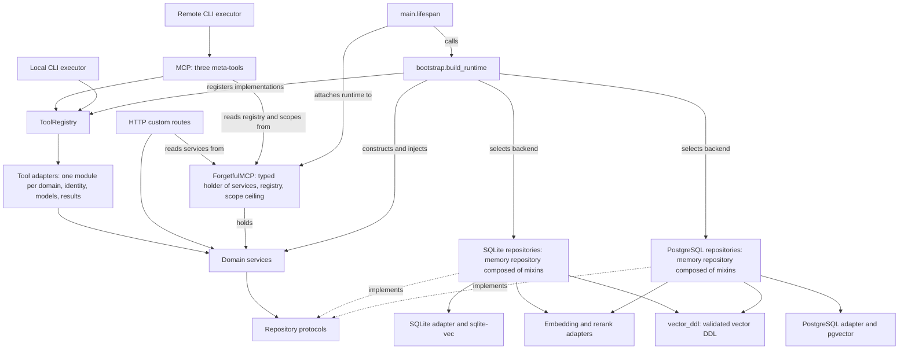

# Forgetful architecture

Reviewable, agent-authored overview, checked against source on 2026-10-08, with boundary changes checked on 2026-10-17
and the structure re-verified on 2026-10-19 against the `quality-gates` branch (`37ee70f`), then updated for the
removal of the graph REST view and subgraph traversal, of plans and tasks, of skills, of files, of documents and
code artifacts, of entities, of the activity bus and stream, and of the container deployment, and for tenants,
fail-closed authentication and projects reduced to a scope string, and for batched embedding with the optional
`gateway` embeddings provider, on the `axmem` branch.
This is a selective interpretation, not an exhaustive dependency inventory.
The component groupings below are inferred for readability; the described execution paths
and wiring were verified against source. Line numbers are inspection starting points and may drift.

Forgetful provides persistent, semantically searchable memories and related knowledge through
MCP tools, HTTP endpoints, and a CLI. Its intended boundary is
**routes → services → protocols → repositories/adapters**, as described in [AGENTS.md](AGENTS.md).
Protocols are Python contracts, not an extra runtime process: services call injected implementations.
SQL, vector storage, provider clients, and database sessions normally stay behind those contracts.
Operational exceptions are called out below rather than hidden by the diagram.
The server runs natively (`uv run main.py`, see the README); the repository ships no container image or compose files.
Docker appears only as a test dependency (the PostgreSQL end-to-end database).

## Component view

Boxes combine multiple classes/files; unless a label names a module or package, they are not declared
packages or separate deployments.
Solid arrows show source-verified use or explicitly labelled startup wiring. Dotted arrows mean
structural implementation of a contract, not inheritance or a request passing through a protocol.
Only the memory repository uses the embedding/rerank branch. Health/auth routes and operational
commands have additional paths omitted here; the diagram does not assert universal layering.

## Entry points and lifecycle

| Inspection point | Responsibility |
| --- | --- |
| [main.py:38](main.py#L38) | Server lifespan configures logging, calls `build_runtime`, attaches services/registry/scopes to the typed `ForgetfulMCP` instance ([server_state.py](app/routes/server_state.py)), then disposes the runtime on normal shutdown. Logging is deferred to protect STDIO transport. |
| [main.py:86](main.py#L86), [main.py:407](main.py#L407) | Construct the typed FastMCP subclass with the configured authentication provider; `_serve` first asks `ensure_startup_allowed` ([auth.py:146](app/config/auth.py#L146)) and exits with code 1 when the configuration is refused (see "MCP, HTTP, and identity"), then runs the app over STDIO or HTTP. Both HTTP branches run the app under Uvicorn directly so lifespan teardown (`dispose_runtime`) completes before a shutdown signal is re-raised; the CORS branch additionally wraps the app with Starlette middleware. |
| [main.py:558](main.py#L558) | Console entry point `cli`: a known subcommand goes to `parser.dispatch`; any other argv falls through to the permanent legacy launcher (`--transport`, `--re-embed`, ...), which rejects the re-embed-only flags when `--re-embed` is absent. |
| [bootstrap.py:167](app/bootstrap.py#L167) | Composition root: choose providers and database, initialize schema, construct repositories, services, tool registry, and instance scope ceiling. |
| [bootstrap.py:146](app/bootstrap.py#L146) | `Services` and `Runtime` collect the instances for front doors. This is explicit constructor injection, not a DI container. |
| [parser.py:268](app/routes/cli/parser.py#L268) | Dispatch CLI serve, re-embed, tool discovery/calls, memory verbs (a `-p/--project` scope string, no project resolver), and the `auth login` / `auth status` commands. |

The bootstrap factories select PostgreSQL or SQLite repositories at
[bootstrap.py:106](app/bootstrap.py#L106), passing embedding and rerank adapters to the memory repository.
Settings live in [settings.py:78](app/config/settings.py#L78); [canonical_choice:45](app/config/settings.py#L45) resolves provider and
log-format choices case-insensitively and raises on a typo instead of silently selecting a default.

The [local executor:18](app/routes/cli/local_executor.py#L18) builds the same runtime, supplies a
CLI context, checks the instance's permitted tools, and executes the registry in process.
The [remote executor:124](app/routes/cli/remote_executor.py#L124) calls the server's three meta-tools
through an MCP client; it does not build a second local database stack.
Both conform to [ToolExecutor:10](app/protocols/executor.py#L10).

## MCP, HTTP, and identity

The active MCP surface is registered by [meta_tools.py:330](app/routes/mcp/meta_tools.py#L330):

1. `discover_forgetful_tools` lists permitted tool metadata, optionally by category.
2. `how_to_use_forgetful_tool` returns detailed metadata for a permitted tool.
3. `execute_forgetful_tool` rejects argument names that are not identifiers
   ([line 290](app/routes/mcp/meta_tools.py#L290)), checks the name/permissions
   ([line 308](app/routes/mcp/meta_tools.py#L308)), injects context, and dispatches it.

Failures leave the meta-tools through [tool_errors.py:36](app/routes/mcp/tool_errors.py#L36): domain and
argument errors keep their authored message, while database and other unexpected errors are logged
server-side and reach the client only as a short generic sentence. The `linking` category of
`discover_forgetful_tools` is a tag filter across the memory link tools.
Caller-supplied names are logged with `%r` and quoted with `!r` inside `ToolError` text (FastMCP
logs every failed tool call with a traceback that ends in that text); argument names are screened
first because CPython copies an unknown keyword verbatim into the `TypeError` that the logs and
traceback would carry.

The full operation set is dynamic: scopes affect what a caller sees.
[tool_metadata_registry.py:858](app/routes/mcp/tool_metadata_registry.py#L858) constructs adapter
callables and registers metadata/implementations together. Despite its filename, this is a module
of registration helpers, not a second `ToolMetadataRegistry` class.
[ToolRegistry.execute:183](app/routes/mcp/tool_registry.py#L183) looks up and awaits the callable.
The adapters live in [app/routes/mcp/adapters](app/routes/mcp/adapters) (memory only; the project and user
adapters are gone), with argument coercion shared in
[arguments.py](app/routes/mcp/adapters/arguments.py);
[tool_adapters.py](app/routes/mcp/tool_adapters.py) only re-exports them so the metadata registry
and the tests keep one import path.
[MemoryToolAdapters.create_memory:53](app/routes/mcp/adapters/memory.py#L53) illustrates identity
resolution, argument conversion, model construction, service delegation, and response formatting.
`main.py` mounts only `meta_tools` ([line 107](main.py#L107)); there are no per-category MCP tool
modules (the seven unmounted `*_tools.py` modules were removed), so every operation is reachable
only through the registry and these three meta-tools.

HTTP endpoints are FastMCP custom routes accepting Starlette requests, rather than a separate
FastAPI application despite the opening docstring in `main.py`.
The services, registry and scope ceiling that the lifespan attaches are declared once on
[ForgetfulMCP:29](app/routes/server_state.py#L29), a `FastMCP` subclass; routes, middleware and
`register(mcp)` take that type, and [server_of:43](app/routes/server_state.py#L43) narrows an MCP
request context to it (the in-process CLI passes a duck-typed shim carrying only the attributes adapters read).
[main.py:103](main.py#L103) mounts health, auth info, and the memory routes.
The root service-info route starts at
[main.py:90](main.py#L90). Route modules share three small helpers so bad client input answers
4xx instead of 500: [request_utils.py](app/routes/api/request_utils.py) (`read_json_object`, `path_id`,
`handle_request_errors`), [query_params.py](app/routes/api/query_params.py) (strict integer and
ISO 8601 query parsing) and [validation.py](app/routes/api/validation.py) (`validation_error_response`
renders pydantic errors as a safe 400). Examples:

| Surface | Source and path |
| --- | --- |
| Health / auth discovery | [health.py:20](app/routes/api/health.py#L20) `/health`; [auth.py:23](app/routes/api/auth.py#L23) `/api/v1/auth/info` reports whether a credential is required and which mode. |
| Memory operations | [memories.py:172](app/routes/api/memories.py#L172) validates a create request and calls `MemoryService` directly; the other memory routes follow this broad shape. |

**Authentication fails closed.** `AUTH_MODE` has no default and names the credential mode
([build_auth_provider:115](app/config/auth.py#L115)): `jwt` (JWT verification), `introspection` (RFC 7662
introspection) or `static` ([StaticTokenVerifier](app/middleware/static_token.py#L19), one token per tenant,
configured only as SHA-256 hashes and compared in constant time), or `none` (no provider, one local tenant).
The GitHub and Google OAuth providers and the CLI browser login are gone.
[ensure_startup_allowed:146](app/config/auth.py#L146) runs first in `_serve` and refuses to start when `AUTH_MODE`
is unset, when a credential mode is asked to run on STDIO (which carries no bearer token), and when `none` is asked
to serve HTTP on anything but a loopback literal (`127.0.0.1`, `::1`; hostnames do not count). A request-level
backstop in the identity code raises when no provider is attached and the mode is not `none`.

**Tenants.** A request acts as one tenant, a string. MCP identity comes from the validated token claims, or from
`DEFAULT_TENANT` when `AUTH_MODE=none` ([get_tenant_from_auth:179](app/middleware/auth.py#L179)); HTTP identity has
its own bearer-token verification/cache path ([_verify_bearer_token:248](app/middleware/auth.py#L248),
[get_tenant_from_request:263](app/middleware/auth.py#L263)) whose cache entries never outlive the token's own
expiry. [tenant_from_claims:149](app/middleware/auth.py#L149) reads the tenant from the claim `tenant_id`, else
`tenant`, else `sub`; a blank claim falls through to the next, and a claim of another type or over 255 characters
is refused. [TenantService.get_or_create_tenant:23](app/services/tenant_service.py#L23) creates the tenant's record
on first use. The record keeps the stored `users` row (the storage layer is replaced later, not migrated), so
services still receive an internal id and every repository query filters on it. A memory that belongs to another
tenant is indistinguishable from a missing one on every path.
[scope_resolver.py:159](app/routes/mcp/scope_resolver.py#L159) intersects token permissions with
the instance ceiling for MCP. Token scopes come from the `scope`/`scp` claim; unrecognised scopes are
ignored, and a claim with scopes but none recognised permits nothing. Its empty-ceiling fallback
permits all registered tools; do not interpret an empty ceiling as deny-all. HTTP routes do not automatically inherit registry scope checks:
inspect their own authorization path before assuming parity. This overview is not a security audit.

## Memory write, retrieval, and linking

**Create:** route/tool adapter → `MemoryService.create_memory` → repository → embedding provider
and database. [memory_service.py:162](app/services/memory_service.py#L162) applies provenance
defaults, persists the memory, then optionally finds similar memories and creates links in a batch.
The repository builds embedding text and persists associations as part of its create operation:
[PostgreSQL:63](app/repositories/postgres/memory_repository.py#L63),
[SQLite:39](app/repositories/sqlite/memory_writes.py#L39).
Memory creation and subsequent automatic linking are separate repository calls, not one service-wide transaction.

Automatic linking uses the configured neighbor limit and similarity threshold, excluding obsolete
memories and the source memory ([PostgreSQL:155](app/repositories/postgres/memory_search.py#L155),
[SQLite:244](app/repositories/sqlite/memory_search.py#L244)). Explicit linking is a separate
service operation ([memory_service.py:441](app/services/memory_service.py#L441)); repository link
methods maintain the bidirectional memory relation and only link memories owned by the calling tenant. Obsolescence is a soft state with reason and
optional replacement; create responses can additionally warn about similar obsolete memories
([memory_service.py:356](app/services/memory_service.py#L356)).

**Query:** [memory_service.py:67](app/services/memory_service.py#L67) asks the repository for
scored primary results, optionally expands one-hop links, deduplicates, and applies token/count
budgets. A `project` scope restricts primaries; linked memories use the same scope only
when `strict_project_filter` is enabled. Budget allocation prioritizes primary results before links
([memory_service.py:557](app/services/memory_service.py#L557)). Within each tier, the budget helper
sorts by importance ([memory_service.py:632](app/services/memory_service.py#L632)); the final response
is not an untouched vector-ranking list. Scores are returned for retained primaries.
Primaries and already-linked memories are excluded before each primary's link cap is applied, a request's
`token_context_threshold` can only lower `MEMORY_TOKEN_BUDGET`, and `truncated` reports drops by either the
token budget or `MEMORY_MAX_MEMORIES`. Token counting is lazy and shared, loads off the event loop, and falls
back to a character-based estimate when tiktoken's encoding is unavailable.

The repositories embed the query and search active, tenant-owned memories with optional importance
and project-scope filters. PostgreSQL uses pgvector cosine distance
([memory_search.py:100](app/repositories/postgres/memory_search.py#L100)); SQLite joins
`memories` to `vec_memories` and computes cosine distance
([memory_search.py:22](app/repositories/sqlite/memory_search.py#L22)).
When reranking is enabled, they retrieve at least `max(k, DENSE_SEARCH_CANDIDATES)` candidates and
rerank when that set exceeds `k`; `query_context` enriches the rerank query, not the initial
embedding query ([PostgreSQL:43](app/repositories/postgres/memory_search.py#L43),
[SQLite:138](app/repositories/sqlite/memory_search.py#L138)).

## Contracts, storage, and implementation variants

| Boundary | Implementations / inspection points |
| --- | --- |
| Domain persistence | [MemoryRepository:21](app/protocols/memory_protocol.py#L21) and sibling files in [app/protocols](app/protocols) define service-facing contracts. Pydantic domain/request/result models live in [app/models](app/models), separate from backend ORM tables. A `project` is a plain string on the memory models (`Memory.project`, trimmed and bounded by `clean_scope` in [memory_models.py](app/models/memory_models.py)); the repository get-or-creates the tenant's `projects` row on first use and keeps the memory-to-project association, so no project model, protocol or service exists. |
| Memory repositories | [PostgresMemoryRepository:54](app/repositories/postgres/memory_repository.py#L54) keeps create/update/obsolete itself and composes search, link, listing and re-embedding mixins ([memory_search.py](app/repositories/postgres/memory_search.py), [memory_links.py](app/repositories/postgres/memory_links.py), [memory_listing.py](app/repositories/postgres/memory_listing.py), [memory_reembedding.py](app/repositories/postgres/memory_reembedding.py)) over [MemoryRepositoryBase:51](app/repositories/postgres/memory_base.py#L51); association writes are in [memory_associations.py](app/repositories/postgres/memory_associations.py). [SqliteMemoryRepository:17](app/repositories/sqlite/memory_repository.py#L17) composes search, write, link and re-embedding mixins over [SqliteMemoryBase:7](app/repositories/sqlite/memory_base.py#L7), with reads in [memory_reads.py](app/repositories/sqlite/memory_reads.py), shared helpers in [memory_queries.py](app/repositories/sqlite/memory_queries.py). The mixin split is structural; both classes still satisfy the one `MemoryRepository` contract. |
| PostgreSQL | [PostgresDatabaseAdapter:36](app/repositories/postgres/postgres_adapter.py#L36) owns async sessions, commit/rollback, initialization, and disposal. Tenant sessions set `app.current_user_id`, but the schema defines no row-level-security policy, so isolation rests on the explicit `user_id` predicates (the tenant's record id) in the repositories. Backend table definitions start at [postgres_tables.py:25](app/repositories/postgres/postgres_tables.py#L25). |
| SQLite | [SqliteDatabaseAdapter:54](app/repositories/sqlite/sqlite_adapter.py#L54) owns file/in-memory connections and sessions, loads sqlite-vec, and creates vector virtual tables. It creates a new data directory `0700` and keeps the database file (and its WAL/SHM) `0600`. Repository queries enforce tenant ownership. Relational tables start at [sqlite_tables.py:56](app/repositories/sqlite/sqlite_tables.py#L56). |
| Schema lifecycle | Both database adapters run Alembic in-process during `init_db` ([SQLite:157](app/repositories/sqlite/sqlite_adapter.py#L157), [PostgreSQL:85](app/repositories/postgres/postgres_adapter.py#L85)); concurrent first starts are serialised by a SQLite write transaction and a PostgreSQL advisory lock. Backend selection and migration execution live in [alembic/env.py:1](alembic/env.py#L1), with revisions in [alembic/versions](alembic/versions). Vector-storage initialization also has adapter-specific work; the vector DDL that cannot use bound parameters (SQLite `vec0` tables, the pgvector column resize) is built by [vector_ddl.py](app/repositories/vector_ddl.py), which accepts a plain identifier and a positive integer and refuses everything else. |
| Embeddings | [EmbeddingsAdapter:10](app/protocols/embedding_protocol.py#L10) defines `generate_embedding` (one text, used by the repositories for a memory or a query) and `generate_embeddings` (several texts in order, used by the re-embedding service; a batch is chunked at `EMBEDDING_BATCH_LIMIT` = 256). Implementations: local FastEmbed (native batching), Azure OpenAI, Google, OpenAI and Ollama (one request per text, through a shared base class), and the optional [GatewayEmbeddingsAdapter](app/repositories/embeddings/gateway_adapter.py) (`EMBEDDING_PROVIDER=gateway`), which posts chunks of up to 256 texts to an HTTP gateway with `httpx.AsyncClient`, retries 429/502/503/504 and network errors up to four attempts (honouring `Retry-After`, one idempotency key per chunk), and refuses a reply whose vector count, width (`EMBEDDING_DIMENSIONS`) or numbers are wrong. No `GATEWAY_*` setting is read unless that provider is selected. Selection is explicit in [bootstrap.py:40](app/bootstrap.py#L40) and matches `EMBEDDING_PROVIDER` case-insensitively. |
| Reranking | [RerankAdapter:20](app/repositories/embeddings/reranker_adapter.py#L20) has local FastEmbed cross-encoder and HTTP implementations. [bootstrap.py:62](app/bootstrap.py#L62) selects one or disables reranking. |

The two persistence backends implement the same broad contracts but use different SQL/vector
mechanisms. This source review does not establish complete behavioral parity or transaction equivalence.
Provider availability, model cache contents, and live database policy configuration were not exercised.

## Other domain and operational components

These are explanatory groupings; they do not imply separate subsystems in the source tree.

| Group | Responsibilities and source anchors |
| --- | --- |
| Tenants | [TenantService](app/services/tenant_service.py#L12) maps the tenant name from the credential to its stored record, creating it on first use. [UserRepository](app/protocols/user_protocol.py) offers lookup by name and create. |
| Re-embedding | [ReEmbeddingService:46](app/services/re_embedding_service.py#L46) coordinates full storage reset/batch embedding/validation of memories and targeted rebuilds, using repository contracts and an embedding adapter. Each batch of memories is embedded with one `generate_embeddings` call; in a targeted rebuild, a failed batch call is retried memory by memory so one rejected memory is reported as `embedding_failed` without failing the others. [main.py:369](main.py#L369) is the operational CLI path: a read-only dry run, and a backup restored on failure or SIGINT/SIGTERM. |
| Backup | [BackupService:9](app/services/backup_service.py#L9) supplies the timestamp and delegates through `BackupAdapter`; [DatabaseBackupAdapter:59](app/repositories/backup_adapter.py#L59) owns SQLite online-backup snapshots and PostgreSQL `pg_dump`/`psql` (owner-only files, optional `BACKUP_DIR`). [create_backup_service:32](app/bootstrap.py#L32) connects them. |

Startup constructs `ReEmbeddingService` and supplies it to MCP handlers; handlers call its
validation and rebuild methods without accessing `MemoryService.memory_repo`.
Embedding interfaces live in `app/protocols`; shared text preparation and owner-only file helpers live in `app/utils`.
User repositories translate duplicate external IDs (tenant names) to `ConflictError`, which `TenantService`
handles by fetching the existing record after the failed transaction has rolled back, so two first requests of
one tenant that race still resolve to one record.

## Enforced import boundaries

The six contracts in `pyproject.toml` enforce these rules, including indirect imports:

| Source | Must not import |
| --- | --- |
| Models, protocols, utilities, settings, logging support, exceptions, version | Services, repositories, routes, bootstrap, authentication middleware/configuration |
| Services | Repositories, routes, bootstrap, authentication middleware/configuration |
| Repositories | Services, routes, bootstrap, authentication middleware/configuration |
| Shared code above and services | `sqlalchemy`, `openai`, `google`, `fastembed`, `httpx`, `ollama`, `subprocess`, `shutil` |
| API/MCP routes, the shared server-state type and authentication middleware | Repositories or bootstrap |
| CLI | Repositories or bootstrap, except the two startup imports below |

All Python files under `app` must be visible to the checker; a regression test verifies this.
Package markers are required, including for SQLite repositories, middleware, utilities, and the
`app/routes/mcp/adapters` package.
Bootstrap constructs implementations. The CLI has its own checked rule: only
`app.routes.cli.local_executor` and `app.routes.cli.context` may import bootstrap directly.
Other CLI modules may reach bootstrap through those startup imports, but may not import
repositories or bootstrap themselves. These exceptions belong only to the CLI rule;
API/MCP handlers still cannot reach bootstrap through CLI code.
Logging configuration may use `app.middleware.logging_middleware` as shared support.
Package initializers and generated version metadata are scanned; they are not extra application layers.
New source areas need an explicit decision about which rules apply.

`main.py` is a standalone startup/operational module, reviewed manually rather than scanned by
Import Linter; tests, migrations, and the evaluation harness are outside the production rules.
Static imports in functions, re-exports, and `TYPE_CHECKING` blocks are checked.
Dynamic imports, runtime attribute access, and arbitrary file/network operations are not checked;
review those in code review and cover behaviour with integration/E2E tests.
The external-library list is explicit, not a complete ban on every possible integration.

Run `uv run lint-imports --no-cache` for the rules alone, or
`uv run pytest tests/architecture/` for the rules, source coverage, and deliberate-violation proofs.
The CI test job runs the latter; [validation notes](docs/dev/architecture-tests.md) describe the proofs.

## Tests and validation entry points

| Suite | What to inspect / run |
| --- | --- |
| Integration | [tests/integration](tests/integration) uses stubbed I/O for service workflows. Start at [test_memory_service.py:13](tests/integration/test_memory_service.py#L13), [test_bootstrap.py](tests/integration/test_bootstrap.py), the authentication tests ([test_auth.py](tests/integration/test_auth.py), [test_auth_factory.py](tests/integration/test_auth_factory.py), [test_static_token_verifier.py](tests/integration/test_static_token_verifier.py), [test_serve_fail_closed.py](tests/integration/test_serve_fail_closed.py)), and the scope and CLI tests. Run `uv run pytest tests/integration/`. |
| SQLite E2E | [tests/e2e_sqlite](tests/e2e_sqlite) exercises the stack with in-memory SQLite; [conftest.py:85](tests/e2e_sqlite/conftest.py#L85) builds the app, and `auth_stack` serves it over HTTP with a real auth provider. [test_auth_modes_sqlite.py](tests/e2e_sqlite/test_auth_modes_sqlite.py) covers every credential mode (valid, invalid, expired, missing token) and [test_tenant_isolation_sqlite.py](tests/e2e_sqlite/test_tenant_isolation_sqlite.py) proves one tenant cannot reach another's memories over REST and MCP (the CLI paths are in `test_cli_verbs.py` and `test_cli_remote.py`). Run `uv run pytest tests/e2e_sqlite/`. |
| PostgreSQL E2E | [tests/e2e](tests/e2e) exercises the PostgreSQL stack; [conftest.py:268](tests/e2e/conftest.py#L268) starts or reuses the Docker database container (`docker run`, pgvector image). Run `uv run pytest -m e2e` with Docker available. |
| Snapshots | Syrupy snapshots (`-m snapshot`) pin public surfaces: [test_snapshots.py](tests/integration/test_snapshots.py) covers CLI help, settings defaults and the database schema; [test_snapshots_sqlite.py](tests/e2e_sqlite/test_snapshots_sqlite.py) covers the MCP meta-tool signatures, the discovered tool catalogue and the HTTP route table. A changed snapshot is a contract change; refresh it deliberately with `uv run pytest -m snapshot --snapshot-update`. |
| Memory budgets | [test_memory_budget_sqlite.py](tests/e2e_sqlite/test_memory_budget_sqlite.py) holds `limit_memory` budgets for bulk create and query; they are enforced only under `--memray` (Linux/macOS) and otherwise run as smoke tests. |
| Agent walkthroughs | [test_harness/walkthrough.py:227](test_harness/walkthrough.py#L227) orchestrates agent sessions; this is evaluation infrastructure, not a production request path. Generated run workspaces are excluded from the map. |

Backend-sensitive changes should exercise both relevant E2E suites; contract/business-rule changes
should first use the focused integration tests. Source links identify tests, not evidence that those
suites have passed for any particular revision. Repository lint command: `uv tool run ruff check .`;
the full set of gates (types, security, complexity, 100% combined coverage, mutation) is described in
[docs/quality-gates.md](docs/quality-gates.md).

## Using the detailed map

The [Mycelium map](docs/assets/mycelium_class_diagram.md) is supporting detail, not required
reading in full. Do not load the entire file into context by default.
It is a **historical snapshot of an older revision**: it was last exported on 2026-10-08 and has not been
regenerated since (Mycelium is not part of the toolchain and no gate reads the map). Use this overview
and current source first. The snapshot predates the October 17 boundary changes (embedding/backup types
and rebuild wiring moved), and it shows none of the later restructuring: both memory repositories split into mixin modules, `tool_adapters.py` split
into `app/routes/mcp/adapters/*`, the typed `ForgetfulMCP` in `app/routes/server_state.py`, and the helper
modules added since. It also still lists the seven per-category `app/routes/mcp/*_tools.py` modules,
which were removed because they were never mounted, the graph REST view (`app/routes/api/graph.py`,
`GraphService`, `get_subgraph_nodes`, `SubgraphResponse`), and planning (`PlanService`, `TaskService`, their
repositories, models, routes and MCP adapters, with the `PLANNING_ENABLED` flag), skills (`SkillService`, its
repositories, models, routes and MCP adapters, with the `SKILLS_ENABLED` flag), and files (`FileService`, its repositories,
models, routes and MCP adapters, with the `FILES_ENABLED` flag and the `memory_file_association` and `entity_file_association`
tables), documents and code artifacts (`DocumentService`, `CodeArtifactService`, their repositories, models, routes and
MCP adapters, with the `memory_document_association` and `memory_code_artifact_association` tables), and entities
(`EntityService`, its repositories, models, routes and MCP adapters, with the `entities`, `entity_relationships`,
`entity_project_association` and `memory_entity_association` tables), and activity (`EventBus`, `ActivityService`, the activity
repositories, the `/api/v1/activity` routes, the `activity_log` table, the `ACTIVITY_*` and `SSE_MAX_QUEUE_SIZE` settings and the memory
access counters `access_count` and `last_accessed_at`), and the project and user services with their routes, MCP adapters,
models and CLI verbs (`ProjectService`, `UserService`, `PatchModel`, the `/api/v1/projects` routes, `get_current_user`,
`update_user_notes`), the GitHub and Google OAuth providers and the CLI token cache, and the `FASTMCP_SERVER_AUTH`,
`DEFAULT_USER_*` and `OAUTH_STORAGE_PATH` settings (replaced by `AUTH_MODE`, `DEFAULT_TENANT`, `AUTH_STATIC_TOKEN_HASHES`), which
were removed later.
Line numbers cited by the map refer to its own revision.

- Find the relevant declaration in the source index, reading that index in chunks if needed.
- Search its diagram identifier for connections and read the relevant line ranges.
- Expand to callers, contracts, alternative implementations, and tests as the task requires.
- Check relevant warnings and filtering notices. Missing edges do not establish independence.
- Verify important relationships against source; static call edges can be uncertain.

Useful IDs in this snapshot, each describing its older single-module shape: `c0016` bootstrap,
`c0276` main, `c0240` ToolRegistry, `c0256` MemoryService, `c0120` MemoryRepository, `c0143` PostgreSQL
memory repository, and `c0171` SQLite memory repository.
The source index begins at [map line 4921](docs/assets/mycelium_class_diagram.md#L4921);
relationships at [5233](docs/assets/mycelium_class_diagram.md#L5233), warnings at
[8246](docs/assets/mycelium_class_diagram.md#L8246). IDs/positions can change on regeneration.

When it was generated, the map was freshly analyzed and exported using Mycelium 1.0.0 with
`--max-classes 1000 --test-path tests --test-path test_harness/runs`.
Repeating the export from the same map produced identical bytes. The output is nonempty and
contains one class diagram; it was checked as Markdown, without a rendered preview.
It contains 8,353 lines, 296 indexed boxes, 2,579 listed relationships,
and 106 extraction warnings. Test filtering removed 4,561 calls and 119 type relationships.
The box count is below the requested cap; full detail is not proof of complete extraction.

Warnings include unresolved or out-of-scope bases (`Protocol`, `BaseModel`, enums) and `EventBus`'s
`asyncio.Task` binding. These mostly name third-party/builtin types, but the diagnostics do not reliably
classify the origin of every unresolved reference. Runtime registration, decorators, and dynamic attributes
require source inspection even when edges exist.

This overview is selective and does not replace source inspection. This map excludes `tests` and
`test_harness/runs`, but includes harness implementation and some debug scripts. Inspect test sources
or request a test-inclusive export when needed. Neither the overview nor the map establishes gap-free coverage.

## Maintenance

After **major code or architecture changes**, review the diagram and explanations and update them
if needed. Mycelium is optional; a source-verified manual update is acceptable. Preserve reviewed
explanations that remain accurate. Keep this overview at most 500 lines, with no column-width limit.
If the generated backup is refreshed, use fresh analysis, keep its JSON outside the repository,
and record exporter version/scope and material warnings, then update the snapshot date and the list of
known-stale shapes in "Using the detailed map". Recheck links and Mermaid rendering.
