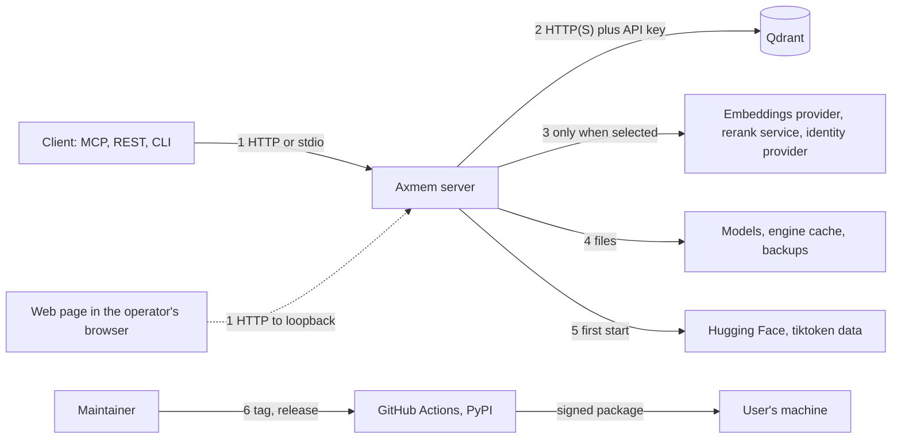
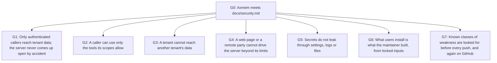

# Assurance case

This page argues that Axmem meets the security requirements in [docs/security.md](security.md), and says where the argument
is weak. It is written from the source and the tests as of 2026-10-29 (version `0.6.0rc1` plus the unreleased changes). It was
written by the project side and has not been reviewed by an independent security reviewer. A [security review](security-review.md)
of the requirements and of the security boundary exists, and says who prepared it (an AI coding agent, adopted by the lead maintainer on 2026-10-31) and what is still open.
Where something is unknown or untested, this page says so.

**Top claim.** Axmem meets its security requirements in [docs/security.md](security.md), for a deployment that follows the
assumptions below.

An assurance case is a chain: a claim, the sub-claims that support it, and the evidence (a file, a test, a gate) under each.
A reader can follow any claim down to something they can run. Evidence is named by path; the requirement identifiers
(`AUTH-1`, `TEN-1`, ...) are those of [docs/security.md](security.md).

## Assumptions

The claim holds only while these hold. Axmem does nothing to check them.

| # | Assumption |
|---|---|
| H1 | The host, its operating system, Python and the NVIDIA driver are not compromised, and only trusted people have shell access to the account that runs Axmem. |
| H2 | Qdrant, and the API key for it, are reachable only by Axmem and the operator. |
| H3 | Any HTTP server that is not on loopback serves TLS itself (`SERVER_SSL_CERTFILE`, NET-7) or sits behind a TLS-terminating reverse proxy, and a reverse proxy or the network limits the rate of requests. Plain HTTP is the default, so this is a choice the operator has to make; the server warns at start when it is not made (NET-9). |
| H4 | The identity provider (`jwt`, `introspection`) is trusted to say who is which tenant, and to issue tokens with the right audience. |
| H5 | The accounts that can change the repository and the PyPI project are not compromised: the lead maintainer's, and the `@vivi7` account, which has admin access but is not a maintainer. [GOVERNANCE.md](../GOVERNANCE.md#access) says the `Axiumine` organization requires two-factor authentication; this page does not check it. |
| H6 | The pinned dependencies contain no vulnerability that is unknown today. Known ones are searched for by `trivy`; unknown ones cannot be. |

## Threat model

### Actors

| Actor | Capability | Goal we defend against |
|---|---|---|
| Unauthenticated network attacker | Can send any HTTP request to a listener they can reach | Read or change memories, run code, exhaust the server |
| Authenticated tenant, hostile | Holds a valid token of one tenant, sends any request | Read or change another tenant's memories, exceed their scopes |
| Web page in the operator's browser | Can make the browser send requests to `127.0.0.1` | Drive a credential-free server (DNS rebinding, cross-origin POST) |
| Agent steered by hostile content | A tenant's own client, tricked by text it read from a memory | Out of Axmem's control; see residual risks |
| Supply-chain attacker | Can publish a malicious dependency, tamper with a GitHub Action, a model file, or the PyPI project | Run code on users' machines through Axmem |
| Careless operator | Misconfigures the server | Expose memories without noticing |

Trusted and out of the model: the operator, the host, Qdrant and its key holders, the identity provider.

### Assets

| Asset | Why it matters |
|---|---|
| The memories of each tenant (title, content, context, keywords, tags, links) | Private work, possibly secrets pasted by an agent |
| Bearer tokens, the Qdrant API key, provider keys, the hashes of static tokens | Anyone with them acts as a tenant or reads the store |
| The tenant boundary itself | One missed filter exposes every tenant |
| The wheel and sdist on PyPI, and the pipeline that signs them | A tampered release runs as the user |
| The model files and the engine cache | Changed bytes would change what the embedder computes |
| Availability of the server and its GPU | The agents depend on it |

### Trust boundaries and entry points

| # | Boundary | Controls (requirement) |
|---|---|---|
| 1 | Client or page to server | AUTH-1 to AUTH-7, SCOPE-1, SCOPE-2, NET-1 to NET-5, NET-7 to NET-11 (TLS, plain-HTTP warning, security headers), SEC-6 (the key password), SEC-7 (in remote mode the CLI sends its token only to a server the person named, never to one a settings file of the working directory names; in local mode that file still names the Qdrant node and the provider URLs: [review](security-review.md#findings) SR-16) |
| 2 | Server to Qdrant | TEN-1 to TEN-3 (the key itself admits every tenant), SEC-2, SEC-5 |
| 3 | Server to optional services | NET-6 (nothing is contacted unless selected); the text sent is listed in [security.md](security.md#what-axmem-does-not-guarantee) |
| 4 | Server to disk | SEC-4, SUP-6 |
| 5 | First start to the internet | SUP-6 (pinned revision, recorded hashes) |
| 6 | Maintainer to user | SUP-1 to SUP-5, SUP-7, SUP-8 |

## Argument

### G1: authentication fails closed

| Sub-claim | Evidence |
|---|---|
| The server refuses to start without a mode, and `none` only where nothing remote can reach it | `app/config/auth.py` `ensure_startup_allowed`; `tests/integration/test_serve_fail_closed.py`, `tests/integration/test_auth_startup_contract.py` (AUTH-1 to AUTH-3) |
| A half-configured credential mode cannot serve | `tests/e2e/test_incomplete_auth_mode_e2e.py`; `app/middleware/auth.py` `_local_tenant` (AUTH-4) |
| A token is accepted only when it is valid, current and meant for this server | `app/middleware/token_verifiers.py`, `app/middleware/static_token.py`; `tests/integration/test_token_verifiers.py`, `tests/integration/test_static_token_verifier.py`, `tests/e2e/test_auth_modes_e2e.py` (AUTH-5) |
| The tenant is never taken from the request | `app/middleware/auth.py` `tenant_from_claims`; `tests/integration/test_auth.py` (AUTH-6) |
| A cached validation cannot outlive its token | `app/middleware/auth.py` `TokenCache`; `tests/integration/test_auth_token_cache.py` (AUTH-7) |

Not shown: that the identity provider issues tokens correctly (H4); that a static token is hard to guess (the guide generates
32 random bytes; nothing enforces the length of a token).

### G2: scopes narrow, never widen

| Sub-claim | Evidence |
|---|---|
| The instance ceiling bounds every token | `app/routes/mcp/scope_resolver.py`; `tests/integration/test_token_scope_fail_open.py`, `tests/e2e/test_token_scope_fail_open_e2e.py` (SCOPE-1) |
| No route or tool skips the check | `app/routes/api/access.py` `ROUTE_TOOLS`, `rest_route`; `tests/e2e/test_rest_scopes_e2e.py` enumerates the routes of the application and fails for one that is neither mapped nor public; `tests/e2e/test_scoped_permissions_e2e.py` for the meta-tools (SCOPE-2) |

Weak point: the defaults are permissive by design. `AXMEM_SCOPES` is `*`, a token with no `scope` claim gets that ceiling, and
so does a static token. A least-privilege deployment has to set the ceiling.

### G3: tenant isolation

| Sub-claim | Evidence |
|---|---|
| Every Qdrant call that touches memories carries the tenant condition | `app/repositories/qdrant/store.py` `scoped`; `tests/integration/test_tenant_chokepoint.py` records the calls of every repository method on a real node and fails for a method that omits the tenant, or for a new method without a scenario (TEN-1) |
| Qdrant is reached only through the store | the `qdrant` import contract (`pyproject.toml`), and the Semgrep rule `axmem-qdrant-write-outside-store` in `.semgrep/axmem.yml` for writes |
| The result is isolation on every access path | `tests/e2e/test_tenant_isolation_e2e.py`, `tests/e2e/test_memory_link_ownership_e2e.py`, `tests/e2e/test_cross_user_reference_checks_e2e.py` (TEN-2, TEN-3) |

Weak points: isolation is a filter, not a separate store (one process, one collection, one API key). The chokepoint test
covers every method of the repository protocol and classifies every client call they make. Code that reached Qdrant by another
road is fenced by the `qdrant` contract of the `imports` gate (`pyproject.toml`), which lets only the Qdrant client, schema and
store modules import `qdrant_client`, and by the Semgrep rule for writes; a read built by hand inside those three modules
would rest on review. The operator commands cross tenants on purpose.

### G4: the network surface is small and bounded

| Sub-claim | Evidence |
|---|---|
| A page cannot drive a credential-free server | `app/middleware/loopback_guard.py`; `tests/integration/test_loopback_guard.py`, `tests/e2e/test_loopback_guard_e2e.py` (NET-1) |
| A request body is bounded | `app/middleware/body_limit.py`; `tests/integration/test_body_limit.py`, `tests/e2e/test_request_bounds_e2e.py` (NET-2) |
| Bad input is a client error | `app/routes/api/request_utils.py`, `app/routes/api/validation.py`; `tests/e2e/test_rest_malformed_requests_e2e.py` (NET-3) |
| CORS cannot hand credentials to every origin | `app/config/settings.py`; `tests/integration/test_cors_credentials.py` (NET-4) |
| Internal errors are not shown to clients | `app/routes/mcp/tool_errors.py`; `tests/integration/test_mcp_meta_tools_hardening.py` (NET-5) |
| The server talks to no one unasked | `tests/e2e/test_standalone_e2e.py` (NET-6) |
| The server can speak TLS itself, and never half of it | `app/config/tls.py` `ensure_tls_usable`, `uvicorn_tls_options`; `tests/integration/test_tls_settings.py`, `tests/integration/test_tls_server.py`, `tests/e2e/test_tls_serve_e2e.py` (a real server over a real certificate chain) (NET-7) |
| A TLS client gets TLS 1.2 or later, and forward secrecy with authenticated encryption on TLS 1.2 | `TLS_CIPHERS` in `app/config/tls.py`; `tests/integration/test_tls_server.py` (NET-8) |
| An operator who left TLS off on a reachable address is told | `app/config/tls.py` `plaintext_exposure_warning`; `tests/integration/test_tls_settings.py` (NET-9) |
| A browser that fetches an answer cannot sniff, frame, cache or forward it, and a refusal is no exception | `app/middleware/security_headers.py`; `tests/integration/test_security_headers.py`, `tests/e2e/test_security_headers_e2e.py` (NET-10, NET-11) |

Weak points: TLS is opt-in and the default is plain HTTP, so a deployment that ignores the start-up warning sends tokens
and memories in clear text; there is no rate limit and no audit log, which are the proxy's and the operator's job and are
listed as non-guarantees. The headers are fixed, are not on the `500` of an unhandled exception, and
`Strict-Transport-Security` is sent only when this process serves TLS. The loopback guard protects `AUTH_MODE=none` only, and
only against browsers: a local process can still use that server, which is what the mode means, and so can a page on any
other loopback origin.

### G5: secrets

| Sub-claim | Evidence |
|---|---|
| Static tokens are stored as hashes, compared in constant time | `app/middleware/static_token.py`; `tests/integration/test_static_token_verifier.py` (SEC-1) |
| Logs mask credentials | `app/config/logging_config.py` `SensitiveDataFilter`; `tests/integration/test_logging_config_contract.py` (SEC-2) |
| The CLI does not store a token | `app/routes/cli/auth_commands.py`; `tests/integration/test_cli_auth_status.py` (SEC-3) |
| In remote mode the CLI sends its token only to a server the person named, not to one that a cloned repository's settings file names (in local mode no token is sent; see the weak points) | `app/config/settings.py` `_TrustedDotEnvSource`, `ignored_server_notice`; `tests/integration/test_cli_server_origin.py` (SEC-7) |
| Backups and exports are private files | `app/utils/private_files.py`; `tests/e2e/test_storage_backup_and_permissions_e2e.py` (SEC-4) |
| The password of the TLS key is a secret value and no refusal repeats it | `app/config/settings.py` `SERVER_SSL_KEYFILE_PASSWORD`; `app/config/tls.py`; `tests/integration/test_tls_settings.py`, `tests/e2e/test_tls_serve_e2e.py` (SEC-6) |
| No credential is committed | the `secret` scanner of `trivy` and the S105/S106 rules of Ruff and Bandit, on every push (SUP-4) |

Weak points: five credentials are plain strings, not secret values (the four provider keys and the introspection client
secret; masking is by pattern, and the filter has no pattern for `secret=`); a static token is hashed with a plain SHA-256;
the Qdrant API key is instance wide. A settings file in the working directory cannot name the server that receives the
token, but it still names the Qdrant node and the provider URLs of a local-mode CLI, so a hostile file in a cloned repository
can send the Qdrant key and the provider keys from the environment or the user settings file, and the memories, to a host of its own; the token is not
sent there. This is accepted ([review](security-review.md#findings), SR-16; advice in
[security.md](security.md#operating-axmem-securely)).

### G6: the supply chain

| Sub-claim | Evidence |
|---|---|
| Inputs are pinned and locked | `pyproject.toml`, `uv.lock`; `tests/architecture/test_build_pins.py` (SUP-1) |
| The actions a workflow runs cannot change underneath it | `tests/architecture/test_workflows.py` requires a 40-character commit for every action; `tests/integration/test_release_guard_generator_tag.py` for the one tag (SUP-2) |
| The release is reproducible, signed and uploaded without a stored credential | `.github/workflows/release.yml`, `.github/workflows/publish.yml`, `scripts/release/guard.py`; `tests/architecture/test_release_workflow.py`, `tests/architecture/test_publish_workflow.py`, `tests/integration/test_release_no_credentials.py`; how to verify: [Checking a release](release.md#checking-a-release) (SUP-3) |
| The package holds source only | `scripts/quality/package.py`; `tests/integration/test_package_guard.py` (SUP-5) |
| Model files are pinned and checked | `app/repositories/embeddings/tensorrt_model.py`; `tests/integration/test_tensorrt_model_contract.py` (SUP-6) |
| Newer versions of the dependencies and the actions are proposed | `.github/dependabot.yml`: weekly pull requests for the GitHub Actions, for `pyproject.toml` with `uv.lock`, and for the Docker base image and the npm packages of the test harness (`test_harness/docker`), which run `ci.yml` and `quality.yml` and are merged by a maintainer; no test, since it is a setting of GitHub's service (SUP-7) |

Weak points: the SLSA generator is called by a tag that the generator's own verifier requires, and the commit it pointed to is
checked by the release script, not by GitHub; the model hashes are recorded on first use; the environment `pypi` has one
required reviewer, the lead maintainer, and self-review is allowed (read from GitHub on 2026-10-29), so the approval is a pause
and not a second check. Dependabot only proposes updates: the pull requests wait for the maintainer, nobody else reviews
them, and the TensorRT packages and the SLSA generator are left out of it and bumped by hand.

### G7: static analysis and scanning before every push

| Sub-claim | Evidence |
|---|---|
| Security lint, local pattern rules and a registry rule set run on `app/`, `main.py` and `scripts/` | the `bandit`, `semgrep` and `ruff` gates; [Quality gates](quality-gates.md#gates) |
| Known-vulnerable dependencies fail the push | the `trivy` gate (`trivy.yaml`: HIGH and CRITICAL, fixed vulnerabilities only) |
| Layering cannot erode | the `imports` and `architecture` gates, `tests/architecture/test_contracts.py` |
| The gates cannot be skipped by mistake | `tests/integration/test_pre_push_pipeline.py`, `tests/architecture/test_workflows.py`; a deliberate `--no-verify` is not prevented |
| Behaviour is covered | 100 % line and branch coverage of `app` and `main.py`, and mutation testing of changed modules |
| CodeQL and OpenSSF Scorecard report on GitHub, as reports and not gates | `.github/workflows/codeql.yml` (Python and the workflow files; a push to `main` and pull requests into it), `.github/workflows/scorecard.yml` (a push to `main`); `tests/architecture/test_workflows.py` (SUP-8) |
| Three functions that read data a client or an identity provider controls are fuzzed | `fuzz/fuzz_token_claims.py`, `fuzz/fuzz_request_arguments.py`, `fuzz/fuzz_terminal_text.py`; `tests/integration/test_fuzz_targets.py` runs each for 300 inputs with a fixed seed; [Fuzzing](fuzzing.md) |

Weak points: only the static gates run in hosted CI; the rest depend on the maintainer's machine. The fuzz harnesses (Atheris)
cover the claims of a token (scopes and tenant), the coercion of tool arguments and of one query parameter, and the cleaning
of terminal text; they do not cover the HTTP surface or the parsing of request bodies by the models. The hooks run each
harness for a few hundred inputs only, and no service runs them continuously: a longer run is a command the maintainer
starts. CodeQL and Scorecard produce reports that a maintainer has to read; an alert or a low score fails no push and no
merge. Dynamic analysis is the end-to-end suite against a real server and those harnesses, not a scanner.

## Secure design principles

The principles of Saltzer and Schroeder, *The Protection of Information in Computer Systems* (1975), with the mechanism in
Axmem and an honest rating. The last two are the paper's additional ones.

| Principle | In Axmem | Rating |
|---|---|---|
| Economy of mechanism | The access-control code is small and in a few modules: `app/middleware/static_token.py` (50 lines), `app/middleware/loopback_guard.py`, `app/middleware/body_limit.py`, `app/routes/api/access.py`, `app/config/auth.py` and `app/middleware/auth.py`, and one function, `scoped`, for the tenant filter. TLS is not implemented here: `app/config/tls.py` (135 lines) checks the files and hands them to uvicorn and Python's `ssl`, and `app/middleware/security_headers.py` (73 lines) only adds headers. The whole stands on FastMCP, Starlette, uvicorn and Qdrant, which are large. | Partial |
| Fail-safe defaults | No default `AUTH_MODE`; an incomplete mode, an unknown scope, an unmapped route, a token without `exp`, a missing issuer or audience, and a half-set TLS configuration (one file, a password alone, a file that does not load) all refuse, and the last never falls back to plain HTTP. But `AXMEM_SCOPES` defaults to `*` and a token with no scope claim gets it, `SERVER_HOST` defaults to `0.0.0.0` (safe against an anonymous caller only because a credential mode is then required), and TLS is off by default, so a credential mode on a reachable address still speaks plain HTTP until the operator turns TLS on or adds a proxy (the start warns). | Partial |
| Complete mediation | Every REST route goes through `rest_route`, every MCP call through the meta-tool check, every Qdrant call through `scoped`; tests enumerate the routes and the repository methods. The only cached decision is a validated token, for at most `TOKEN_CACHE_TTL_SECONDS` and never past the token's expiry, so revocation of an introspected token can lag by that time. | Met, with the cache caveat |
| Open design | The source is public under the AGPL, the mechanisms are described in the open, and the only secrets are keys and tokens. | Met |
| Separation of privilege | Read and write are separate scopes, and a release needs a tag (restricted by a ruleset), a signing run and a reviewer's approval. But one token is enough to act as a tenant, and today one person holds every release role. | Partial |
| Least privilege | Scopes and the instance ceiling; tenants see only their own data; CI jobs have a read-only token and no secret; backups are owner-only. But the Qdrant API key is all-powerful, the default ceiling is `*`, and the server process can read every tenant. | Partial |
| Least common mechanism | Tenants share one process, one Qdrant collection, one API key and one GPU; the separation is a filter. | Not met by design |
| Psychological acceptability | One setting (`AUTH_MODE`) decides the mode, refusals say what to set (the TLS refusals name the setting and the way out), and the guide shows how to make a token hash and how to serve TLS. The scope model (a token with only foreign scopes gets nothing) needs reading. | Partial |
| Work factor | Static tokens are meant to be 32 random bytes, which a hash lookup does not weaken; `jwt` relies on the provider's keys. A weak token is not detected. | Partial |
| Compromise recording | Some rejections are logged by client id, `/health` goes to 503 on a failed model, and releases are in a public transparency log. There is no audit log of reads and writes per tenant. | Not met |

## Common weaknesses

### OWASP Top 10 (2021 edition)

| Category | Mitigation | Enforcing gate or test | Gap |
|---|---|---|---|
| A01 Broken access control | Tenant filter, scopes on every route and tool, fail-closed authentication | `tests/integration/test_tenant_chokepoint.py`, `tests/e2e/test_rest_scopes_e2e.py`, `tests/e2e/test_tenant_isolation_e2e.py` | Qdrant key is instance wide; default scope ceiling is `*` |
| A02 Cryptographic failures | Axmem implements no cryptography; it uses SHA-256 for token hashes and cache keys, `hmac.compare_digest`, FastMCP's JWT verification, and Python's `ssl` for the optional TLS: 1.2 or later, ECDHE with AES-GCM or ChaCha20-Poly1305 on 1.2, no weaker suite offered, a half-set or unloadable key pair refuses to start, and the key password is a secret value (NET-7, NET-8, SEC-6) | `tests/integration/test_static_token_verifier.py`, `tests/integration/test_token_verifiers.py`, `tests/integration/test_tls_settings.py`, `tests/integration/test_tls_server.py`, `tests/e2e/test_tls_serve_e2e.py` | **Plain HTTP is the default**: TLS needs the option or a proxy (H3), and a server left on plain HTTP sends tokens and memories in clear text; a start-up warning is the only nudge (NET-9). No encryption of stored memories; plain SHA-256 for static tokens; no client certificates; a certificate renewal needs a restart; the permissions of the key file are not checked |
| A03 Injection | No SQL; Qdrant filters are built from typed models in one function; no `eval`, `exec`, `pickle` or shell in `app/`; caller-supplied names are quoted in logs and errors | Semgrep `axmem-unsafe-deserialization`, `axmem-subprocess-shell-true`; Bandit; Ruff `S` | Prompt injection through stored content is not mitigated |
| A04 Insecure design | Written requirements with tests, a threat model, fail-closed defaults, layering enforced by import contracts | this page; `imports` and `architecture` gates | No independent design review; no rate limiting or audit log by design |
| A05 Security misconfiguration | Invalid settings stop the server with one line; a half-set TLS configuration stops it too instead of serving plain HTTP; CORS is off; `credentials` need named origins; loopback guard; fixed security headers on every answer, the refusals included; a warning when plain HTTP is served beyond loopback | `tests/integration/test_auth_startup_contract.py`, `tests/integration/test_cors_credentials.py`, `tests/integration/test_settings_failure_contract.py`, `tests/integration/test_tls_settings.py`, `tests/integration/test_security_headers.py`, `tests/e2e/test_security_headers_e2e.py` | Plain HTTP and `SERVER_HOST=0.0.0.0` remain the defaults (the warning does not refuse); the headers are fixed and absent from a `500`; operator can still put a proxy in front of `none`; a settings file in the working directory still sets `QDRANT_URL` and the provider URLs for a local-mode CLI (it can no longer set `AXMEM_SERVER`: SEC-7, [review](security-review.md#findings) SR-1), so a hostile file in a cloned repository can send the Qdrant key from the environment, and the memories, to a host of its own (accepted: SR-16) |
| A06 Vulnerable and outdated components | Exact pins, hashed lock, `trivy` on every push and in CI; Dependabot proposes updates every week, and GitHub proposes security updates; fixed vulnerabilities are recorded in the changelog | `trivy` gate; `.github/dependabot.yml` (a setting of GitHub's service, so no test) | A maintainer has to merge the proposals, and nobody else reviews them; the TensorRT packages and the SLSA generator are bumped by hand; `trivy` ignores vulnerabilities without a fix; native libraries |
| A07 Identification and authentication failures | Four explicit modes, `exp`, issuer and audience required, constant-time comparison | `tests/integration/test_token_verifiers.py`, `tests/e2e/test_auth_modes_e2e.py` | No lockout or rate limit; static tokens never expire; `nbf` is not checked; no MFA of our own (the identity provider's job) |
| A08 Software and data integrity failures | Signed, reproducible releases; commit-pinned actions; hashed lock; model hashes; no deserialization of untrusted data | `tests/architecture/test_release_workflow.py`, `tests/architecture/test_workflows.py`, `tests/integration/test_tensorrt_model_contract.py` | Model hashes are trusted on first use; SLSA generator by tag; one release reviewer |
| A09 Security logging and monitoring failures | Credential masking in logs; some rejections logged; `/health` reports a dead model | `tests/integration/test_logging_config_contract.py`, `tests/integration/test_token_verifier_rejections_logged.py` | No audit log, no alerting |
| A10 Server-side request forgery | The server fetches only URLs the operator configured; no tool or route argument is fetched (`source_url` is stored text) | structure (no such code path); Semgrep `axmem-http-call-without-timeout` | Operator-configured URLs (JWKS, introspection, providers) are trusted |

### CWE Top 25 (2024 edition)

The edition is the 2024 one; later editions may list others. "Python" means the weakness needs memory-unsafe code, which
Axmem does not contain: the wheel is pure Python (`py3-none-any`).

| CWE | Weakness | Mitigation and enforcement | Gap |
|---|---|---|---|
| 79 | Cross-site scripting | The server returns JSON only and renders no HTML | A client that renders memory content must escape it |
| 787, 125, 416, 119, 476, 190 | Memory-safety errors, integer overflow | Python; no C extension of Axmem's own | Native dependencies (TensorRT, CUDA, NumPy, tokenizers); `trivy` sees only known, fixed vulnerabilities |
| 89 | SQL injection | No SQL database exists; filters are typed Qdrant models | None known |
| 352 | Cross-site request forgery | Authentication is a bearer header, not a cookie; CORS off by default; the loopback guard refuses foreign `Origin` on a credential-free server (`tests/e2e/test_loopback_guard_e2e.py`, `tests/integration/test_cors_credentials.py`) | `CORS_ORIGINS=["*"]` with a token held by a page is the operator's choice |
| 22 | Path traversal | No route or tool takes a path; paths come from the operator's command line; an export file is written without following a planted link (`app/utils/private_files.py`) | The operator commands trust the path they are given |
| 78, 77 | OS command injection | No subprocess in `app/` or `main.py`; Semgrep `axmem-subprocess-shell-true`; Ruff and Bandit shell rules | `scripts/` call `git`, `gh` and `uv` with argument lists (Ruff `S603`/`S607` are waived there, on purpose) |
| 862, 863 | Missing and incorrect authorization | `rest_route`, `ROUTE_TOOLS`, scope resolution, tenant filter | See A01 gaps |
| 434 | Unrestricted file upload | No upload route; `axmem import` reads a file the operator names | None known |
| 94 | Code injection | No `eval`/`exec` in `app/`; Semgrep `axmem-unsafe-deserialization`; Bandit | None known |
| 20 | Improper input validation | Pydantic models with bounds, strict query parsing, a body limit (`tests/e2e/test_request_bounds_e2e.py`, `tests/e2e/test_rest_malformed_requests_e2e.py`); the Atheris harness `fuzz/fuzz_request_arguments.py` for the coercion of tool arguments | The harnesses do not cover the HTTP surface or the parsing of request bodies by the models |
| 287, 306 | Improper or missing authentication | Fail-closed start, request-level backstop, three public routes only, enumerated by a test | None known beyond A07 |
| 269 | Improper privilege management | Scopes cannot widen the ceiling (`tests/integration/test_token_scope_fail_open.py` and `tests/e2e/test_token_scope_fail_open_e2e.py`) | Default ceiling is `*` |
| 502 | Deserialization of untrusted data | Only JSON is read from clients; no `pickle` or `yaml.load`; Semgrep rule | The model files are parsed by TensorRT; they are pinned and hashed |
| 200 | Exposure of sensitive information | Generic MCP errors, masked logs, another tenant's id answers like a missing one, owner-only backups | `/health`, `/` and `/api/v1/auth/info` show service, version, mode and model-failure text without a credential |
| 918 | Server-side request forgery | See A10 | Operator-configured URLs are trusted |
| 798 | Hard-coded credentials | No default secret (`QDRANT_API_KEY` is empty); `trivy` secret scan on every push; Ruff and Bandit `S105`/`S106` | Test constants are waived in `tests/` |
| 400 | Uncontrolled resource consumption | Body limit, field bounds, token cache capacity, a cap on the length of text the log filter scans, bounded patterns | No rate limiting; one GPU serves one call at a time; no limit on how slowly a request may arrive (not tested); one pattern of the CLI is quadratic ([review](security-review.md#findings), SR-4) |

Two weaknesses outside the Top 25 that the TLS option and the headers address:

| CWE | Weakness | Mitigation and enforcement | Gap |
|---|---|---|---|
| 319 | Cleartext transmission of sensitive information | `SERVER_SSL_CERTFILE`/`SERVER_SSL_KEYFILE` (NET-7, NET-8); a warning at start for plain HTTP beyond loopback (NET-9); `Strict-Transport-Security` when this process serves TLS (NET-11); a Qdrant API key over `http://` to a remote host is warned about (SEC-5); `tests/integration/test_tls_server.py`, `tests/e2e/test_tls_serve_e2e.py` | **The default is plain HTTP.** No warning for the other credentials that can travel over `http://` (introspection client secret, rerank and gateway keys, JWKS fetch): [review](security-review.md#findings), SR-2; the CLI sends `AXMEM_TOKEN` to whatever `http://` server it is told to |
| 1021 | Improper restriction of rendered UI layers (clickjacking) | `X-Frame-Options: DENY` and `frame-ancestors 'none'` on every answer except a `500` (NET-10); there is no page to frame | None known |

## Residual risks

1. **TLS is opt-in, and there is no rate limiting or audit log in the server.** Plain HTTP is the default: the operator
   must turn TLS on (`SERVER_SSL_CERTFILE` and `SERVER_SSL_KEYFILE`) or put a TLS-terminating proxy in front, and must
   supply the rate limit (H3). The server warns at start and does not refuse, so a deployment that ignores the warning
   sends tokens and memories in clear text. The security headers are fixed and absent from a `500`.
2. **Isolation is a filter.** One missed condition would expose every tenant, and the Qdrant API key bypasses it. The
   chokepoint test is the main defence.
3. **Permissive defaults.** `AXMEM_SCOPES=*`, tokens without a scope claim, and static tokens get every tool.
4. **Prompt injection.** Stored content is returned as written. Defence belongs to the client.
5. **One maintainer.** The lead maintainer writes, reviews and approves; a second reviewer is not required for
   the maintainer's own changes ([GOVERNANCE.md](../GOVERNANCE.md)), and the release approval is given by the same
   person, the only required reviewer of the release environments. No other maintainer exists and no successor is named. The
   `@vivi7` account is an owner of the organization and an admin of the repository, but it is not a maintainer. No independent
   review of this page or of the code has taken place.
6. **Little fuzzing, and no dynamic scanner against the HTTP surface.** Three Atheris harnesses cover token claims, the
   coercion of tool arguments and terminal text, run for a few hundred inputs in the hooks ([Fuzzing](fuzzing.md)); the
   end-to-end suite is the only dynamic check of the HTTP surface.
7. **Hosted CI runs only the static gates.** The tests run on one machine, and a push with `--no-verify` skips them.
8. **Supply chain edges.** Models are trusted on first use, the SLSA generator is called by tag, dependency updates are
   proposed by Dependabot and merged by one maintainer without a second reviewer (the TensorRT packages and the SLSA
   generator are bumped by hand), and native libraries are checked only for known, fixed vulnerabilities. CodeQL and
   Scorecard are reports, not gates.
9. **Unknown vulnerabilities in dependencies** (H6), FastMCP and Starlette above all, since they carry the HTTP surface.
10. **Open findings of the [security review](security-review.md#findings).** It was prepared by an AI coding agent, not by
    an independent person, and lists code findings that are not fixed (SR-2 to SR-6, SR-10 and SR-12 are open at the time of
    writing, 7 of its 16; SR-1, the only Medium, is fixed in the tree, as are SR-14 and SR-15; six are accepted limits, among them SR-16: a
    settings file in the working directory still names the Qdrant node and the provider URLs of a local-mode CLI, so running
    `axmem` in a checkout you do not trust can send the Qdrant key from your environment or your user settings file, and the memories, to a host of the
    file's choosing; the review found none that reaches another tenant's data, which does not prove there is none). A second human
    reviewer has not read the code.

## Reading this page again

A claim here becomes false if the mechanism it cites is removed or weakened. The tests named under each claim are what notice
that; if you change authentication, scopes, the tenant filter, a middleware, a workflow or the release scripts, check the
claims above that cite them. To report a flaw in this argument, or a vulnerability, see [SECURITY.md](../SECURITY.md).
