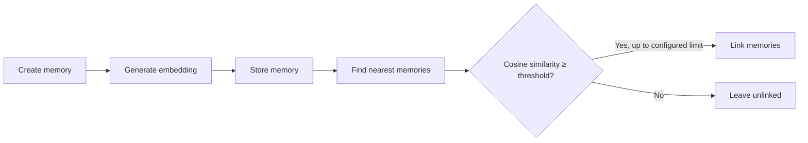

# Axmem Search Functionality

This section details Axmem's search functionality and associated configuration.

## Auto-Linking Pipeline

When a new memory is created, Axmem automatically builds knowledge graph connections:

**How it works:**

1. **Encode** - Title, content, context, keywords, and tags are combined into a vector embedding
2. **Store** - The embedding is stored in Qdrant as the vector of the memory's point, next to its payload
3. **Similarity Search** - Existing memories are searched for semantic similarity
4. **Threshold** - Only matches with cosine similarity of at least 0.7 are kept by default
5. **Auto-Link** - Up to `MEMORY_NUM_AUTO_LINK` qualifying memories are linked (bidirectional)

This builds a knowledge graph where related concepts connect without manual intervention.

Set `MEMORY_SIMILARITY_THRESHOLD` to adjust the cutoff. Auto-linking does not use
cross-encoder reranking.

## Query Search Pipeline

`query_memory` searches by vector similarity. When reranking is enabled and more
than `k` candidates are returned, a cross-encoder reranks them using `query` and
`query_context`. The query and every memory are embedded on the NVIDIA GPU with TensorRT in strict fp32
by default (see [GPU models](gpu-models.md)), and the local reranker runs there too; `RERANKING_PROVIDER=HTTP` sends the candidates to a rerank service
instead. There is no sparse full-text search or reciprocal rank fusion.

---

## Embedding Providers

### TensorRT (default)
`EMBEDDING_PROVIDER=TensorRT` embeds in the server process on the NVIDIA GPU with `BAAI/bge-small-en-v1.5` (CLS pooling, L2 normalised, 384 dimensions, texts truncated to 512 tokens), in strict fp32. There is no CPU path: a host without a usable GPU refuses to start and says why. See [GPU models](gpu-models.md).

### [Google](https://ai.google.dev/gemini-api/docs/embeddings)
Google embedding models available via the Gemini API (`EMBEDDING_PROVIDER=Google`, `GOOGLE_AI_API_KEY`). The requested vector width is `EMBEDDING_DIMENSIONS`.

### [Azure](https://learn.microsoft.com/en-us/azure/ai-foundry/openai/tutorials/embeddings?view=foundry-classic&tabs=command-line)
Azure Foundry OpenAI embeddings (`EMBEDDING_PROVIDER=Azure`; endpoint, deployment, API version and key are required).

### OpenAI
OpenAI embeddings (`EMBEDDING_PROVIDER=OpenAI`, `OPENAI_API_KEY`), or any OpenAI-compatible server such as llama.cpp, vLLM or LiteLLM through `OPENAI_BASE_URL`.

### Ollama
A local [Ollama](https://ollama.com/) server (`EMBEDDING_PROVIDER=Ollama`, `OLLAMA_BASE_URL`). The `ollama` SDK is installed with the server.

### Gateway
An optional HTTP embeddings gateway (`EMBEDDING_PROVIDER=gateway`). Texts go out in batches of up to 256 and the returned vectors are checked against `EMBEDDING_DIMENSIONS` before they are stored. See the [gateway settings](configuration.md#gateway-embedding-provider-configuration).

Every remote provider checks the width of each reply against `EMBEDDING_DIMENSIONS` and refuses a reply of another width or with a number that is not finite. Changing the provider, the model or the width for memories that already exist needs a re-embed, see [Embedding Migration](embedding_migration.md).

## Configuration

The settings below drive search; [Search Configuration](configuration.md#search-configuration) and [Memory Configuration](configuration.md#memory-configuration) explain each one.

| Setting | Default | Effect |
|---|---|---|
| `EMBEDDING_PROVIDER` | `TensorRT` | Which embedder runs: `TensorRT`, `Azure`, `Google`, `OpenAI`, `Ollama` or `gateway` |
| `EMBEDDING_MODEL`, `EMBEDDING_DIMENSIONS` | `BAAI/bge-small-en-v1.5`, `384` | The model and the width of its vectors |
| `MEMORY_NUM_AUTO_LINK` | `3` | How many similar memories a new memory is linked to (`0` turns auto-linking off) |
| `MEMORY_SIMILARITY_THRESHOLD` | `0.7` | Minimum cosine similarity for an automatic link |
| `DENSE_SEARCH_CANDIDATES` | `20` | Candidates fetched by vector search before reranking (at least `k` are always fetched) |
| `RERANKING_ENABLED`, `RERANKING_PROVIDER` | `true`, `TensorRT` | Whether and where candidates are reranked: `TensorRT` on the local GPU or `HTTP` |
| `MEMORY_TOKEN_BUDGET`, `MEMORY_MAX_MEMORIES` | `8000`, `20` | Token and count budgets of a query result |
| `OBSOLETE_WARNING_ENABLED`, `OBSOLETE_WARNING_THRESHOLD` | `true`, `0.89` | The obsolete-memory warning on `create_memory` |
